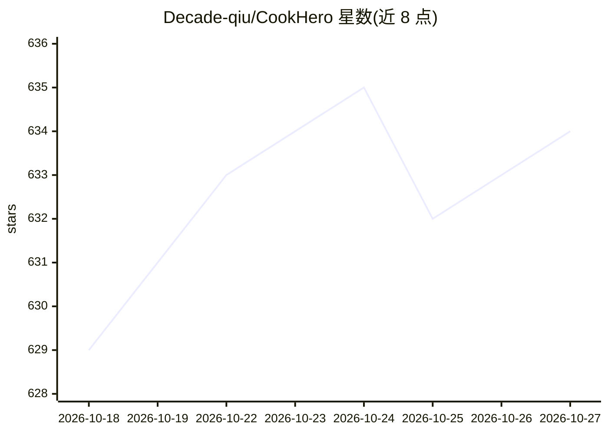

# Decade-qiu/CookHero

⭐ 634 · Python · Apache-2.0 · 推送 2026-08-21 · [GitHub](https://github.com/Decade-qiu/CookHero) · 个人维护 · 中文 README

**面向个人用户的 AI 饮食烹饪助手：菜谱问答与饮食管理平台**

融合 LLM、RAG、Agent 与多模态的 Web 全栈饮食管理平台，面向厨房新手、健身/减脂/控糖人群及家庭场景。提供对话式菜谱查询、周饮食计划、文字/图片 AI 饮食记录与营养分析；Agent 部分采用 ReAct 推理 + 工具调用，支持内置/自定义 Subagent 与 MCP 协议扩展；检索采用向量 + BM25 + Reranker 混合并配 Redis 多级缓存，并集成 RAGAS 评估与 LLM 用量统计。部署需 Python 3.12、Node.js 18，通过 Docker Compose 启动 PostgreSQL/Milvus/Redis/MinIO 等基础设施，图片场景有数量与大小限制（最多 4 张、单张 10MB）。

## 筛选速览

| 维度 | 判定 | 备注 |
|---|---|---|
| AI 角色 | `ai-native` | 本体是模型或模型工具 |
| 许可风险 | `permissive` | Apache-2.0 |
| 部署形态 | `self-host` | docker 或自建部署 |
| 模型依赖 | — | README 未给出锁定关系 |
| 硬件要求 | — | 无带数字的原话,不猜 |
| 安装摩擦 | `low` | 无编译、无系统依赖或容器化 |
| 成熟度 | — | 结构信号不足 |

## 能力要点

- ReAct Agent + 内置/自定义 Subagent，支持 MCP 协议动态扩展工具
- 向量 + BM25 + Reranker 混合检索，Redis 多级缓存
- 文字/图片 AI 饮食记录与自动营养估算，DALL-E 3 图片生成
- RAGAS 质量评估、LLM Token 统计与提示词注入防护等安全体系

## 适用场景

- 按周规划三餐并用 AI 记录实际饮食、追踪营养目标
- 自然语言查询菜谱并上传私人食谱构建个人知识库
- 拍照识别食材/菜品获取烹饪指导
- 通过自定义 Subagent 与 MCP 工具扩展个人饮食助手能力

## 场景标签

`聊天机器人` `AI 助手` · 领域:对话与助手

## 证据(README 行号)

> L17: **CookHero**（烹饪英雄）是一个融合 LLM、RAG、Agent、多模态与营养数据分析的个性化饮食管理平台。它不仅是菜谱库，更是一位能陪你做计划、做记录、看数据、给建议的“饮食管理英雄助手”，帮助你把烹饪与健康目标变成可
> L22: - 🧾 **AI 记录**：文字/图片一键记录，自动估算热量与宏量营养
> L43: ### 1. Agent 智能饮食管家

## 星数曲线

2026-10-18 629 → 2026-10-27 634（+5）

---
*卡片 v1 · prompt 1.4 · 生成 2026-10-21 · 置信度 high · 依据 README sha `b8d63e44bccf` · [字段定义](../../DATASET.md)*
