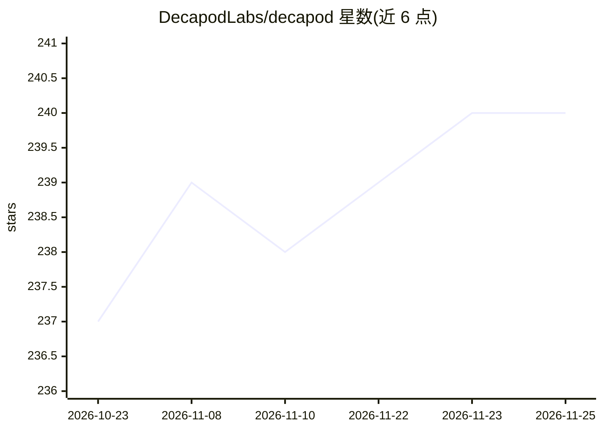

# DecapodLabs/decapod

⭐ 240 · Rust · MIT · 推送 2026-11-23 · [GitHub](https://github.com/DecapodLabs/decapod) · [官网](http://decapodlabs.ai) · 组织维护

**为编码 agent 提供仓库级治理内核与验证证据追踪**

Decapod 是一个 Rust CLI 治理内核，为编码 agent 提供持久化状态、强制边界和提交绑定的验证证据。它将需求、决策、任务所有权和验证证据随仓库保存，跨 agent 与会话延续；agent 通过记录意图、认领任务、在隔离工作区执行、运行验证、输出可检验的 proof artifact。支持本地与云端后端，包含嵌入式工程 Constitution 参考层。安装通过 cargo binstall，每仓库执行一次 init。

## 筛选速览

| 维度 | 判定 | 备注 |
|---|---|---|
| AI 角色 | `ai-ecosystem` | LLM/agent 周边工具 |
| 许可风险 | `permissive` | MIT |
| 部署形态 | `library` | 以包/库形式分发 |
| 模型依赖 | — | README 未给出锁定关系 |
| 硬件要求 | — | 无带数字的原话,不猜 |
| 安装摩擦 | `low` | 无编译、无系统依赖或容器化 |
| 成熟度 | — | 结构信号不足 |

## 能力要点

- 持久化治理状态存于仓库 .decapod/ 目录，跨 agent 与会话延续
- 多 agent 并发认领任务与隔离工作区，冲突显式可见
- 验证证据绑定变更，失败检查保持未完成状态可追溯
- 本地优先、无守护进程，默认本地验证，可选 Buildkite 远程预检

## 适用场景

- 多个编码 agent 并行开发时明确任务所有权与边界
- 跨会话/交接时保留未满足需求与验证状态
- 要求变更完成须有可检验证据的团队协作流程

## 场景标签

`多智能体` `编码 Agent` · 领域:Agent 开发

## 证据(README 行号)

> L5:  Metacognition for AI agents.
> L92: Decapod is a **Rust CLI**. Each invocation runs, returns its result, and exits. It is local-first and daemonless.

## 星数曲线

2026-10-23 237 → 2026-11-25 240（+3）

---
*卡片 v1 · prompt 1.4 · 生成 2026-11-25 · 置信度 high · 依据 README sha `6623debdc9c9` · [字段定义](../../DATASET.md)*
