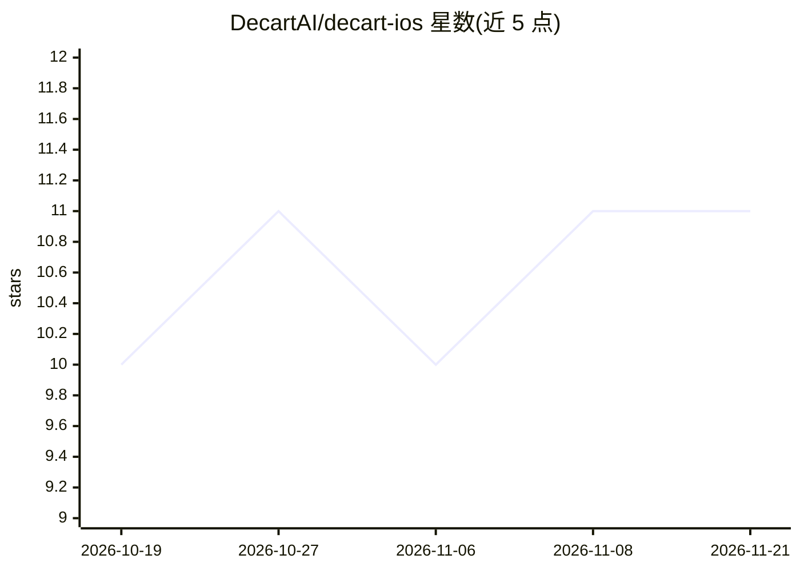

# DecartAI/decart-ios

⭐ 11 · Swift · MIT · 推送 2026-11-08 · [GitHub](https://github.com/DecartAI/decart-ios) · [官网](https://docs.platform.decart.ai/sdks/swift) · 组织维护

**iOS/macOS 开发者接入 Decart AI 实时视频与生成能力的 Swift SDK**

面向 Swift 开发者的 Decart AI 原生 SDK，封装三类 API：基于 LiveKit 的实时视频处理（含自动重连与生成计费事件）、Queue API 异步视频生成（提交-轮询-下载）、同步图像生成。支持 lucy 系列实时/图像/视频模型、视频编辑与 Restyle、虚拟试穿，可选 fast 模式（限美国区部分模型，2 倍计费）。使用 Swift 6.2.1 async/await，要求 iOS 17+/macOS 12+，需从 platform.decart.ai 获取 API key。

## 筛选速览

| 维度 | 判定 | 备注 |
|---|---|---|
| AI 角色 | `ai-ecosystem` | LLM/agent 周边工具 |
| 许可风险 | `permissive` | MIT |
| 部署形态 | `None` |  |
| 模型依赖 | — | README 未给出锁定关系 |
| 硬件要求 | — | 无带数字的原话,不猜 |
| 安装摩擦 | `low` | 无编译、无系统依赖或容器化 |
| 成熟度 | — | 结构信号不足 |

## 能力要点

- RealtimeManager 提供 LiveKit 实时视频流处理与自动重连
- QueueClient 支持长时视频生成任务的提交、轮询与下载
- 覆盖 lucy 系列实时视频编辑、Restyle、虚拟试穿与图像生成模型
- 前置摄像头 MirroringVideoProcessor 预翻转编码帧

## 适用场景

- 在 iOS 应用中接入实时 AI 视频处理流
- 调用 Queue API 生成或编辑视频（含虚拟试穿、Restyle）
- 图像到图像的 AI 转换功能集成

## 场景标签

`图像生成` `视频生成` `图像视频处理` · 领域:内容生成

## 证据(README 行号)

> L7: Native Swift SDK for Decart AI - Real-time video processing and AI generation for iOS & macOS.
> L11: Decart iOS SDK provides three primary APIs:
> L13: - **RealtimeManager** - Real-time video processing with LiveKit streaming, automatic reconnection, and generation t

## 星数曲线

2026-10-19 10 → 2026-11-21 11（+1）

---
*卡片 v1 · prompt 1.4 · 生成 2026-11-19 · 置信度 high · 依据 README sha `2a86ddb0b218` · [字段定义](../../DATASET.md)*
