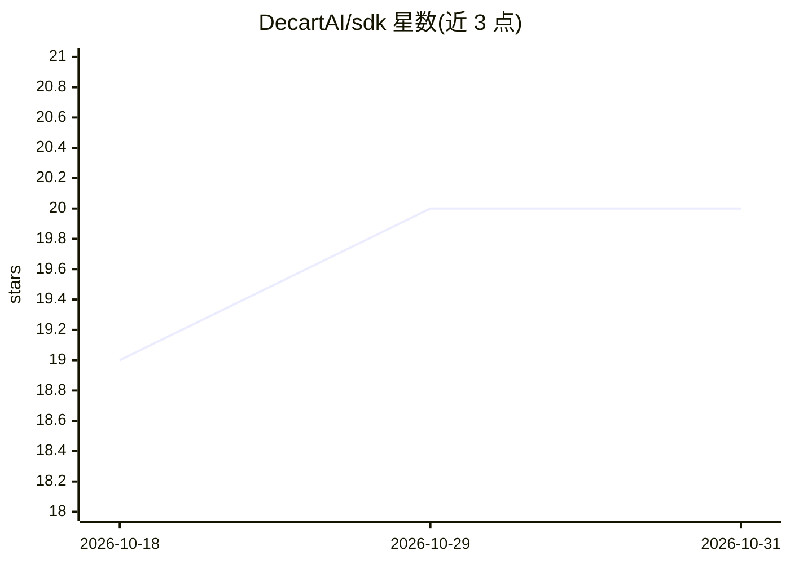

# DecartAI/sdk

⭐ 20 · TypeScript · MIT · 推送 2026-10-26 · [GitHub](https://github.com/DecartAI/sdk) · [官网](https://docs.platform.decart.ai/sdks/javascript) · 组织维护

**接入 Decart 实时视频生成模型的 JavaScript SDK**

面向开发者的 JS/TS SDK，用于调用 Decart 平台模型：基于 LiveKit/WebRTC 的实时视频变换（摄像头流转入、变换流输出）、多人观看（subscribeToken 共享观看凭证）、连接前预检与 glass-to-glass 延迟测量、异步队列式视频生成任务，以及服务端铸造短时客户端令牌并可离线验证。含连接重试、容量退避、fast 模式等机制。需 Decart API key，通过 npm 安装。

## 筛选速览

| 维度 | 判定 | 备注 |
|---|---|---|
| AI 角色 | `ai-ecosystem` | LLM/agent 周边工具 |
| 许可风险 | `permissive` | MIT |
| 部署形态 | `library` | 以包/库形式分发 |
| 模型依赖 | — | README 未给出锁定关系 |
| 硬件要求 | — | 无带数字的原话,不猜 |
| 安装摩擦 | `low` | 无编译、无系统依赖或容器化 |
| 成熟度 | — | 结构信号不足 |

## 能力要点

- 实时视频变换会话：传入 MediaStream，选择模型并接收变换后的远端流（LiveKit 通道）
- subscribeToken 观看模式：观看者无需摄像头即可接收生成流
- 连接质量分层：preflight 网络预检、会话内质量信号与 glass-to-glass 延迟测量
- 短时客户端令牌（默认 60 秒过期）与 JWKS 离线验证

## 适用场景

- 在 Web 应用中接入 Decart 实时视频风格化/换装模型
- 为直播或互动场景构建主持人与多个观看者的实时流
- 通过队列 API 提交异步视频生成任务并轮询结果
- 服务端铸造短时令牌，避免在前端暴露 API key

## 场景标签

`视频生成` · 领域:内容生成

## 证据(README 行号)

> L3: A JavaScript SDK for Decart's models.
> L24: Realtime connections are LiveKit-backed in the SDK. Existing client usage stays the same: provide a

## 星数曲线

2026-10-18 19 → 2026-10-31 20（+1）

---
*卡片 v1 · prompt 1.4 · 生成 2026-10-29 · 置信度 high · 依据 README sha `5deb68784f8e` · [字段定义](../../DATASET.md)*
