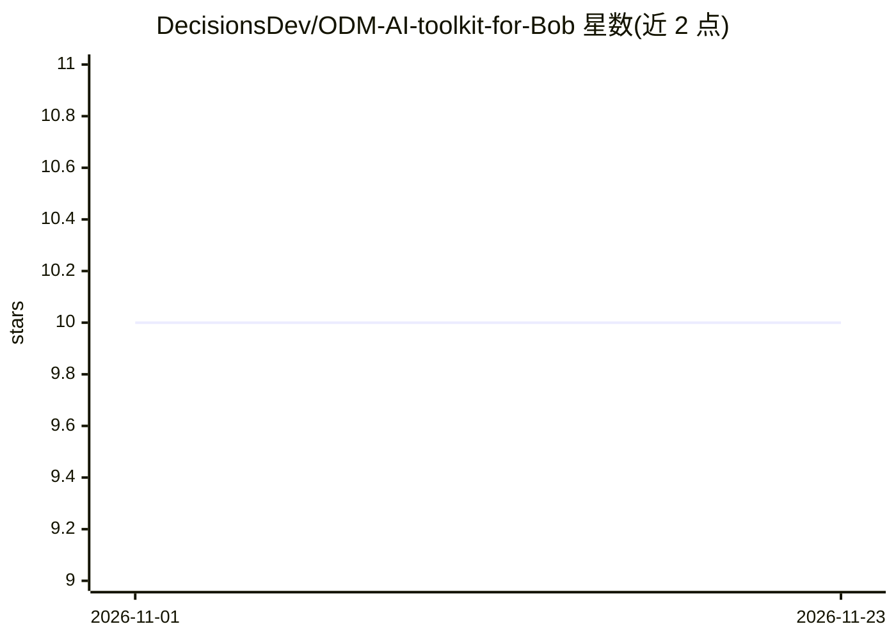

# DecisionsDev/ODM-AI-toolkit-for-Bob

⭐ 10 · Java · Apache-2.0 · 推送 2026-10-28 · [GitHub](https://github.com/DecisionsDev/ODM-AI-toolkit-for-Bob) · 组织维护

**把自然语言业务规则生成为 IBM ODM 决策服务的 AI 工具包**

提供两种形态：面向 IBM Bob 的自定义模式，以及兼容开放 Agent Skills 格式的 odm-builder 技能（可装在 Claude 等代理中）。由 AI 助手根据自然语言描述或政策文档生成完整可部署的 ODM 决策服务，包括 Java XOM、BOM 词汇表、BAL 业务规则与决策表、ruleflow 编排及部署配置。技能版附带 odm.jar CLI，负责生成 XML 样板并自动安装规则编译器，仅支持 ODM 9.x。

## 筛选速览

| 维度 | 判定 | 备注 |
|---|---|---|
| AI 角色 | `ai-native` | 本体是模型或模型工具 |
| 许可风险 | `permissive` | Apache-2.0 |
| 部署形态 | `self-host` | docker 或自建部署 |
| 模型依赖 | locked-api |  |
| 硬件要求 | — | 无带数字的原话,不猜 |
| 安装摩擦 | `low` | 无编译、无系统依赖或容器化 |
| 成熟度 | — | 结构信号不足 |

## 能力要点

- 生成完整 ODM 项目：XOM、BOM、BAL 规则、决策表、ruleflow、部署配置
- odm-builder 技能兼容开放 Agent Skills 格式，可安装于 Claude、IBM Bob 及其他代理
- CLI 自动生成带一致 UUID 与交叉链接的 XML 样板，并按 ODM 版本自动选择 JDK 与规则编译器
- 可修改、审查既有项目：定位未触发规则、修复构建失败、重新设计 ruleflow

## 适用场景

- 从政策文档一键生成欺诈检测、贷款审批等决策服务
- 为既有 ODM 规则项目追加规则或扩展模型
- 用 odm check 审查规则设计并分析规则依赖以设计 ruleflow
- 通过 ODM Management MCP Server 部署到 Decision Center 或 RES 控制台

## 场景标签

`代码生成` · 领域:编码与开发

## 证据(README 行号)

> L5: Build production-ready IBM ODM Decision Services in minutes, not days. This toolkit turns natural language descripti
> L8: - 🛠️ **ODM Designer skill**: the `odm-builder` skill for Claude, IBM Bob, and any agent that supports the open Agent
> L81: - **An AI assistant**: IBM Bob, Claude, or another Agent Skills-compatible agent

## 星数曲线

2026-11-01 10 → 2026-11-23 10（+0）

---
*卡片 v1 · prompt 1.4 · 生成 2026-11-20 · 置信度 mid · 依据 README sha `a158a3995cec` · [字段定义](../../DATASET.md)*
