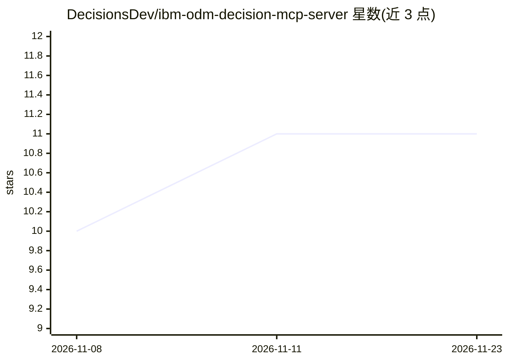

# DecisionsDev/ibm-odm-decision-mcp-server

⭐ 11 · Python · Apache-2.0 · 推送 2026-11-05 · [GitHub](https://github.com/DecisionsDev/ibm-odm-decision-mcp-server) · 组织维护

**把 IBM ODM 决策服务接入 AI 助手的 MCP 服务器**

一个 Python 编写的 MCP 服务器，将 IBM Operational Decision Manager（ODM）的决策服务（规则集）以工具形式暴露给 AI 助手与编排平台，支持检索并调用决策服务、本地资源存储管理，以及 Zen API Key、Basic Auth、OpenID Connect（含 PKJWT）等多种认证方式和 SSL/TLS、mTLS 安全连接配置。通过 uvx 从源码直接运行，需自备 Python 3.13+ 环境与可访问的 IBM ODM 部署。提供面向 Claude Desktop、IBM watsonx Orchestrate、IBM Bob 的集成指南与演示视频。

## 筛选速览

| 维度 | 判定 | 备注 |
|---|---|---|
| AI 角色 | `ai-ecosystem` | LLM/agent 周边工具 |
| 许可风险 | `permissive` | Apache-2.0 |
| 部署形态 | `self-host` | docker 或自建部署 |
| 模型依赖 | locked-api |  |
| 硬件要求 | — | 无带数字的原话,不猜 |
| 安装摩擦 | `low` | 无编译、无系统依赖或容器化 |
| 成熟度 | — | 结构信号不足 |

## 能力要点

- 将 ODM 决策（规则集）作为工具添加并调用
- 支持 Zen API Key、Basic Auth、OpenID Connect/PKJWT 多种认证
- 支持 SSL 证书校验与 mTLS 客户端认证配置
- 提供 Claude Desktop / watsonx Orchestrate / Bob 集成指南

## 适用场景

- 让 AI 助手在对话中直接调用企业 ODM 决策服务
- 在工作流编排平台中动态调用业务规则
- 为已部署 ODM 的企业把业务逻辑以工具形式开放给终端用户和机器人

## 场景标签

`AI 助手` · 领域:对话与助手

## 证据(README 行号)

> L5: The IBM ODM Decision MCP Server bridges IBM ODM with modern AI assistants and orchestration platforms.
> L14: - **Tool Integration:** Add and invoke ODM decisions (aka rulesets) as tools
> L41: - **Python 3.13 or higher** - This MCP server is written in Python and requires Python 3.13+

## 星数曲线

2026-11-08 10 → 2026-11-23 11（+1）

---
*卡片 v1 · prompt 1.4 · 生成 2026-11-19 · 置信度 mid · 依据 README sha `0d8b700bc26e` · [字段定义](../../DATASET.md)*
