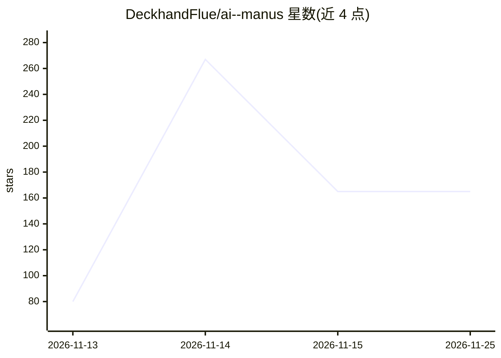

# DeckhandFlue/ai--manus

⭐ 165 · Apache-2.0 · 推送 2026-11-15 · [GitHub](https://github.com/DeckhandFlue/ai--manus) · 个人维护

**自主执行代码与控制浏览器的通用 AI Agent 助手**

Manus 是面向家庭、学习与轻量工作场景的自主 AI Agent：用户以自然语言下达指令，Agent 自行编写并执行脚本、打开网页并与之交互、完成多步任务（如查资料、填表、整理研究笔记）。README 描述其整合代码自动化与浏览器控制于同一流程，支持跨会话记忆工作模式。定位为非企业级平台的小型助手。需注意：README 未给出任何安装命令、源码结构或接入的具体模型服务，仅有使用流程说明与配置建议。

## 筛选速览

| 维度 | 判定 | 备注 |
|---|---|---|
| AI 角色 | `ai-native` | 本体是模型或模型工具 |
| 许可风险 | `permissive` | Apache-2.0 |
| 部署形态 | `None` |  |
| 模型依赖 | — | README 未给出锁定关系 |
| 硬件要求 | — | 无带数字的原话,不猜 |
| 安装摩擦 | `low` | 无编译、无系统依赖或容器化 |
| 成熟度 | — | 结构信号不足 |

## 能力要点

- 自主执行代码：Agent 自行编写并运行脚本完成任务
- 浏览器控制：自主导航网页、填表、采集信息
- 代码与浏览器操作可在同一工作流中衔接
- 面向学习、家庭与轻量办公的小规模任务场景

## 适用场景

- 让 Agent 代为完成查网页、填表格等重复性操作
- 整理研究笔记、运行小脚本辅助学习
- 小型报告的多页面信息汇总

## 场景标签

`浏览器自动化` `编码 Agent` · 领域:效率与自动化

## 证据(README 行号)

> L10: - **Autonomous Code Execution:** Manus AI agent runs code on its own to complete tasks, so you can focus on decisio
> L11: - **Browser Control Made Simple:** Manus browser control lets the agent navigate websites, fill forms, and gather i
> L18: Manus is an autonomous AI agent designed to run code and control a browser on your behalf. Instead of acting like a

## 星数曲线

2026-11-13 80 → 2026-11-25 165（+85）

---
*卡片 v1 · prompt 1.4 · 生成 2026-11-17 · 置信度 mid · 依据 README sha `0f78ee3a5dd2` · [字段定义](../../DATASET.md)*
