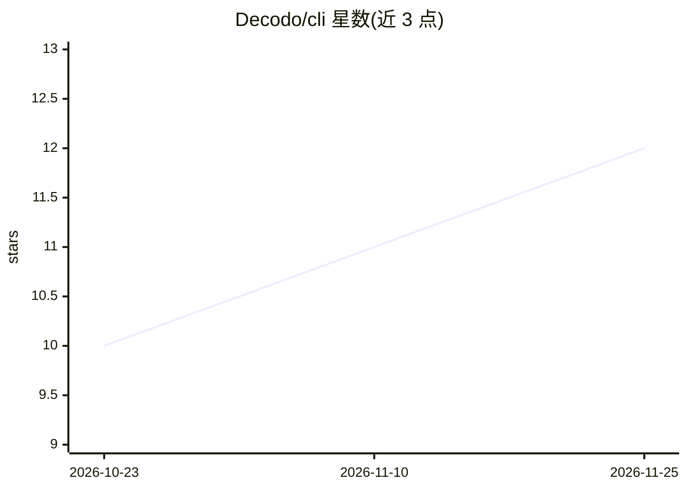

# Decodo/cli

⭐ 12 · TypeScript · MIT · 推送 2026-11-04 · [GitHub](https://github.com/Decodo/cli) · [官网](https://decodo.com/scraping/web) · 组织维护

**终端网页抓取 CLI，供脚本与 AI agent 调用获取网页数据**

封装 Decodo Web Data API 的命令行抓取工具：将每个 API 目标包装为子命令，支持网页抓取、搜索、站点映射、爬取与截图，输出 JSON、NDJSON、Markdown 与 PNG。服务端处理 JavaScript 渲染、反爬绕过与 CAPTCHA。面向 shell 脚本、CI/CD 流水线与编码 agent，提供管道友好输出与明确退出码。需 Decodo 账号与 API key，按订阅计费，免费额度 10K 请求。

## 筛选速览

| 维度 | 判定 | 备注 |
|---|---|---|
| AI 角色 | `ai-enhanced` | 去掉 AI 部分产品仍成立 |
| 许可风险 | `permissive` | MIT |
| 部署形态 | `library` | 以包/库形式分发 |
| 模型依赖 | — | README 未给出锁定关系 |
| 硬件要求 | — | 无带数字的原话,不猜 |
| 安装摩擦 | `low` | 无编译、无系统依赖或容器化 |
| 成熟度 | — | 结构信号不足 |

## 能力要点

- scrape/search/map/crawl/screenshot 一级命令及 Google、Amazon、TikTok 等模式化目标子命令
- JSON/NDJSON/Markdown/PNG 输出，TTY 与管道模式自动切换，退出码区分认证/校验/限流错误
- crawl --wait 支持启动后轮询收取结果，适配 agent 异步工作流
- 依赖 115M+ 住宅 IP 代理基础设施与地理定向

## 适用场景

- 在 shell 脚本和 CI/CD 中抓取或搜索网页数据
- 让 Cursor、Claude Code 等编码 agent 以子进程方式调用抓取
- 从终端查询 Amazon/Walmart/Target 等电商数据
- 监控 Google/Bing 搜索结果页（SERP）

## 场景标签

`网页抓取` · 领域:效率与自动化

## 证据(README 行号)

> L5: A web scraping CLI for the Decodo Web Data API.
> L20: It wraps every API target as a subcommand and provides shell-native output modes for structured data extraction, sc
> L234: The Decodo CLI is built for AI agent web scraping and agentic workflows. Coding agents such as Cursor, Claude Code

## 星数曲线

2026-10-23 10 → 2026-11-25 12（+2）

---
*卡片 v1 · prompt 1.4 · 生成 2026-11-19 · 置信度 high · 依据 README sha `3a5ad9d29729` · [字段定义](../../DATASET.md)*
