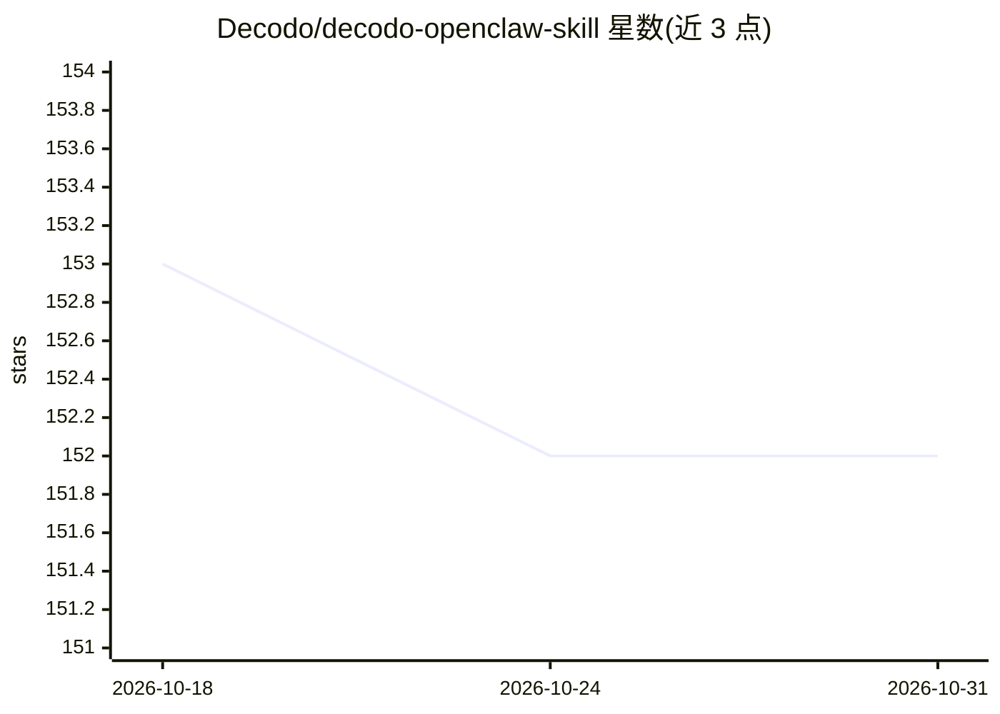

# Decodo/decodo-openclaw-skill

⭐ 152 · Python · 推送 2026-10-29 · [GitHub](https://github.com/Decodo/decodo-openclaw-skill) · [官网](https://decodo.com) · 组织维护

**为 OpenClaw agent 提供网页抓取工具的技能包（Decodo API）**

将 Decodo Web Scraping API 封装为 OpenClaw 技能：通过 SKILL.md 暴露 7 个可被 agent 调用的工具，包括 Google 实时搜索（SERP）、任意网页转 Markdown、Amazon 商品页/搜索解析、YouTube 字幕提取、Reddit 帖子与版块抓取。依托 Decodo 代理基础设施处理 JavaScript 渲染、反爬与地理定位，输出结构化 JSON 或 Markdown。需 Python 3.9+、OpenClaw 运行时及 Decodo 账号（Base64 token 认证），使用 CLI 或 agent 自动发现调用。

## 筛选速览

| 维度 | 判定 | 备注 |
|---|---|---|
| AI 角色 | `ai-ecosystem` | LLM/agent 周边工具 |
| 许可风险 | `none` | — |
| 部署形态 | `library` | 以包/库形式分发 |
| 模型依赖 | — | README 未给出锁定关系 |
| 硬件要求 | — | 无带数字的原话,不猜 |
| 安装摩擦 | `low` | 无编译、无系统依赖或容器化 |
| 成熟度 | — | 结构信号不足 |

## 能力要点

- 7 个工具：Google 搜索、通用抓取、Amazon 商品/搜索、YouTube 字幕、Reddit 帖子/版块
- SKILL.md 定义工具，OpenClaw 兼容 agent 自动发现调用
- 输出结构化 JSON 或 Markdown
- 依赖最少，仅需 Python 与 Requests

## 适用场景

- 让 AI agent 在工作流中实时检索 Google 并抓取网页
- 为 RAG 管道采集与更新网页语料
- 电商价格监控与商品数据解析
- 提取 YouTube 字幕或 Reddit 内容做分析

## 场景标签

`网页抓取` · 领域:效率与自动化

## 证据(README 行号)

> L8: This OpenClaw skill integrates Decodo's Web Scraping API into any OpenClaw-compatible AI agent or LLM pipeline. It e

## 星数曲线

2026-10-18 153 → 2026-10-31 152（-1）

---
*卡片 v1 · prompt 1.4 · 生成 2026-10-22 · 置信度 mid · 依据 README sha `ddb1eb6e9f5d` · [字段定义](../../DATASET.md)*
