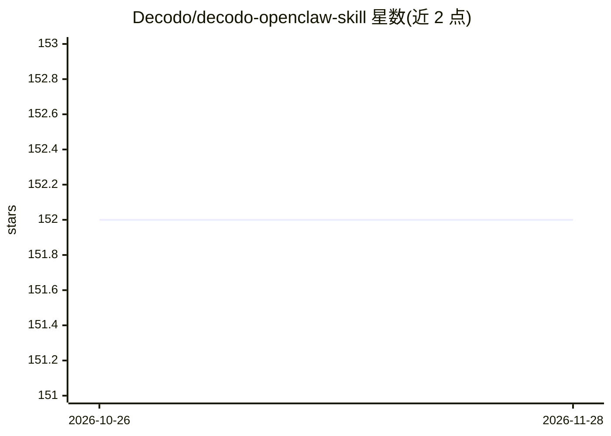

# Decodo/decodo-openclaw-skill

⭐ 152 · Python · 推送 2026-11-25 · [GitHub](https://github.com/Decodo/decodo-openclaw-skill) · [官网](https://decodo.com) · 组织维护

**为 OpenClaw AI agent 提供网页抓取工具的技能包**

将 Decodo Web Scraping API 封装为 OpenClaw 技能（SKILL.md 格式），向 AI agent 暴露 5 个可调用工具：Google 搜索结构化结果、任意网页转 Markdown、Amazon 商品解析与搜索、YouTube 字幕提取。依赖 Decodo 的代理基础设施处理 JavaScript 渲染与验证码，输出结构化 JSON/Markdown。需要 Python 3.9+、Decodo 账号的 Base64 认证令牌，通过环境变量或 .env 配置；代码以 MIT 许可发布，但抓取服务本身依赖 Decodo 商业 API。

## 筛选速览

| 维度 | 判定 | 备注 |
|---|---|---|
| AI 角色 | `ai-ecosystem` | LLM/agent 周边工具 |
| 许可风险 | `none` | — |
| 部署形态 | `library` | 以包/库形式分发 |
| 模型依赖 | — | README 未给出锁定关系 |
| 硬件要求 | — | 无带数字的原话,不猜 |
| 安装摩擦 | `low` | 无编译、无系统依赖或容器化 |
| 成熟度 | — | 结构信号不足 |

## 能力要点

- 5 个可被 agent 调用的工具：google_search、universal、amazon、amazon_search、youtube_subtitles
- SKILL.md 格式，OpenClaw 兼容 agent 自动发现并调用工具
- 返回结构化 JSON 或干净 Markdown，面向 LLM 处理
- 单一 Base64 令牌认证，仅需 Python 与 Requests

## 适用场景

- 让 AI agent 实时检索 Google 搜索结果用于事实核查或 RAG
- 抓取任意网页转 Markdown 供总结或构建数据集
- 监控 Amazon 商品价格与竞品信息
- 提取 YouTube 视频字幕做内容分析

## 场景标签

`网页抓取` · 领域:效率与自动化

## 证据(README 行号)

> L8: This OpenClaw skill integrates Decodo's Web Scraping API into any OpenClaw-compatible AI agent or LLM pipeline. It e
> L67: This skill ships with a SKILL.md file that defines all tools in the OpenClaw skill format. OpenClaw-compatible agen
> L42: - Decodo account with access to the Web Scraping API

## 星数曲线

2026-10-26 152 → 2026-11-28 152（+0）

---
*卡片 v1 · prompt 1.4 · 生成 2026-11-27 · 置信度 mid · 依据 README sha `1175b465701b` · [字段定义](../../DATASET.md)*
