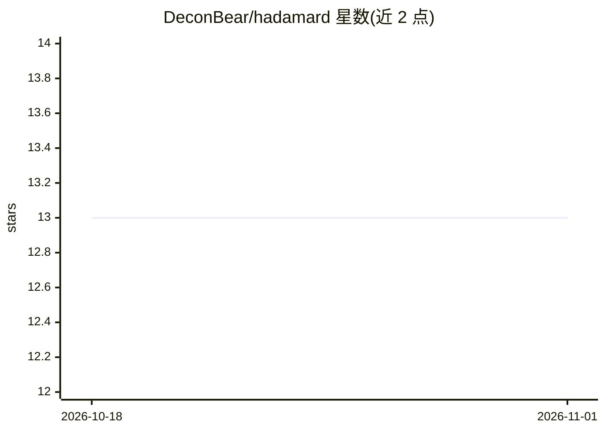

# DeconBear/hadamard

⭐ 13 · TypeScript · MIT · 推送 2026-10-15 · [GitHub](https://github.com/DeconBear/hadamard) · [官网](https://deconbear.github.io/hadamard/) · 个人维护 · 中文 README

**多智能体 TypeScript SDK/运行时：多会话协作与 CLI 桥接**

面向软件交付、AI4S 流水线与实验管理的多智能体框架：单一 TypeScript 运行时提供工具、技能、持久会话、记忆与 MCP，多个 agent 可跨 provider 并行交流、审查与调度；内置 bridge 将已安装的 agent CLI（Claude Code、Codex、Cursor 等）作为子进程管理。随附终端 UI 与 Electron 桌面 GUI，兼容 Anthropic/OpenAI 协议的 provider。要求 Node.js 22.13+ 或 24，以 npm 包 actoviq-agent-sdk 发布；可视化 Agent 图编辑器仍在迭代。

## 筛选速览

| 维度 | 判定 | 备注 |
|---|---|---|
| AI 角色 | `ai-ecosystem` | LLM/agent 周边工具 |
| 许可风险 | `permissive` | MIT |
| 部署形态 | `library` | 以包/库形式分发 |
| 模型依赖 | — | README 未给出锁定关系 |
| 硬件要求 | — | 无带数字的原话,不猜 |
| 安装摩擦 | `low` | 无编译、无系统依赖或容器化 |
| 成熟度 | `idea` | |

## 能力要点

- 单运行时提供工具、技能、持久会话、记忆与 MCP
- bridge 将 7 种 agent CLI（Claude Code、Codex、Cursor 等）作为子进程管理
- 支持任意 Anthropic 兼容或 OpenAI 兼容 provider
- 随附终端 UI（hadamard-tui）与 Electron 桌面 GUI（hadamard-gui）

## 适用场景

- 在软件开发或科研实验中编排多个并行协作的 agent
- 把已有的 agent CLI 作为子进程纳入统一会话管理
- 通过终端 REPL 或桌面 GUI 与多 agent 团队对话

## 场景标签

`Agent 框架` `多智能体` · 领域:Agent 开发

## 证据(README 行号)

> L12: **Hadamard** exists to make agent engineering and research controllable. Multiple agents on different providers tal
> L39: Put your provider settings at `~/.hadamard/settings.json` — any Anthropic-compatible or OpenAI-compatible provider 

## 星数曲线

2026-10-18 13 → 2026-11-01 13（+0）

---
*卡片 v1 · prompt 1.4 · 生成 2026-10-31 · 置信度 high · 依据 README sha `31e4e7a6050c` · [字段定义](../../DATASET.md)*
