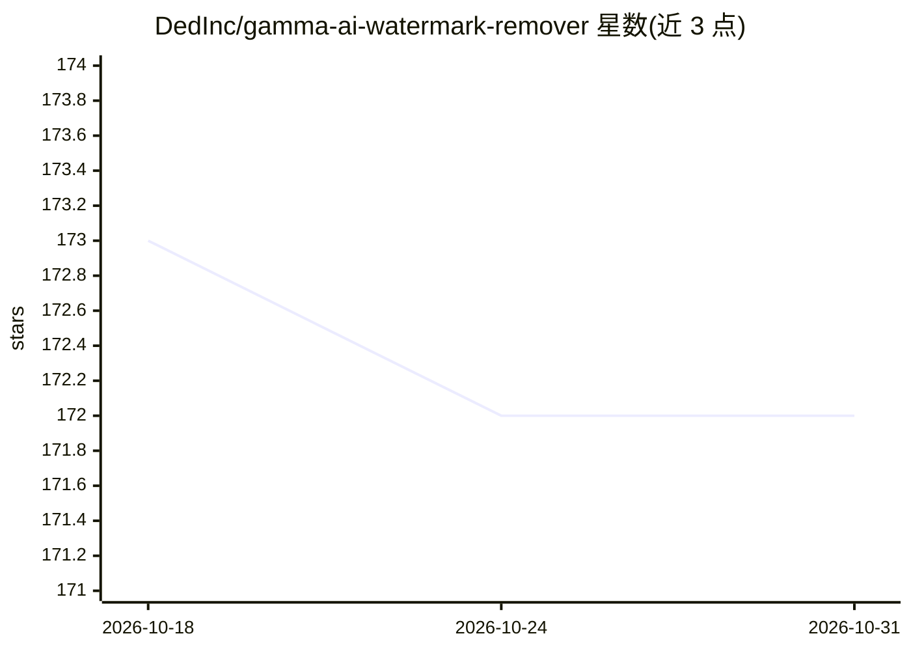

# DedInc/gamma-ai-watermark-remover

⭐ 172 · HTML · MIT · 推送 2026-06-24 · [GitHub](https://github.com/DedInc/gamma-ai-watermark-remover) · 个人维护

**本地网页工具：去除 gamma.app 导出文件中的水印**

基于 FastAPI 的本地 Web 工具，用于去除 gamma.app 免费版导出文件中的 "Made with Gamma" 水印。支持 PDF（PyMuPDF 扫描链接 gamma.app 的右下角图片）、PPTX（python-pptx 定位母版版式中的水印形状）、Keynote（仅 macOS，经 AppleScript 驱动 Keynote 转 pptx 处理后转回）与 PNG 幻灯片 ZIP（逐行采样背景色修补右下角水印区）。检测逻辑为启发式坐标与超链接匹配，若 Gamma 更改导出结构则需更新代码。README 声明仅供教育用途。

## 筛选速览

| 维度 | 判定 | 备注 |
|---|---|---|
| AI 角色 | `ai-enhanced` | 去掉 AI 部分产品仍成立 |
| 许可风险 | `permissive` | MIT |
| 部署形态 | `library` | 以包/库形式分发 |
| 模型依赖 | — | README 未给出锁定关系 |
| 硬件要求 | — | 无带数字的原话,不猜 |
| 安装摩擦 | `low` | 无编译、无系统依赖或容器化 |
| 成熟度 | — | 结构信号不足 |

## 能力要点

- PDF/PPTX/Keynote/PNG ZIP 四种导出格式的水印移除
- PPTX 通过定位母版版式全局移除水印
- 网页 UI 支持批量上传、深浅色主题与会话内历史
- 本地运行，无需外部服务

## 适用场景

- 移除 gamma.app 免费版导出 PDF/PPTX 中的品牌水印
- 批量处理 Gamma 导出的 PNG 幻灯片 ZIP
- macOS 上处理 Keynote 格式的 Gamma 导出文件

## 场景标签

`图像视频处理` · 领域:感知与多模态

## 证据(README 行号)

> L3: A local web tool to strip the **"Made with Gamma"** branding from files exported from gamma.app free accounts — incl
> L5: It runs a **FastAPI** backend that parses the document structure to identify and remove specific watermark elements 

## 星数曲线

2026-10-18 173 → 2026-10-31 172（-1）

---
*卡片 v1 · prompt 1.4 · 生成 2026-10-22 · 置信度 mid · 依据 README sha `a55f72946e7b` · [字段定义](../../DATASET.md)*
