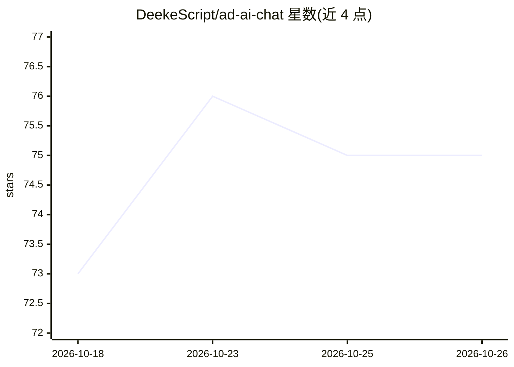

# DeekeScript/ad-ai-chat

⭐ 75 · HTML · 推送 2026-10-21 · [GitHub](https://github.com/DeekeScript/ad-ai-chat) · [官网](http://101.43.47.185:8080) · 个人维护 · 中文 README

**付费商用的 LLM 角色扮演聊天系统源码（含语音与多端）**

基于 LLM 的角色扮演聊天系统，提供 AI 女友/男友式单聊、多角色群聊、自定义角色与剧情（含红楼梦等 IP 场景），内置 300+ 语音音色的高拟人语音回复，并带 AI 助手自动生成话术、推进剧情。技术栈为 Node.js 后端 + Android 端 + 基于 Ant Design 的 PC Web 端，配多用户系统与管理后台（模型参数、音色、配额、审核策略可配置）。源码售价 2000 元并提供部署服务，README 未给出安装命令或公开仓库构建步骤，需加微信联系获取体验账号。

## 筛选速览

| 维度 | 判定 | 备注 |
|---|---|---|
| AI 角色 | `ai-native` | 本体是模型或模型工具 |
| 许可风险 | `none` | — |
| 部署形态 | `None` |  |
| 模型依赖 | — | README 未给出锁定关系 |
| 硬件要求 | — | 无带数字的原话,不猜 |
| 安装摩擦 | `low` | 无编译、无系统依赖或容器化 |
| 成熟度 | — | 结构信号不足 |

## 能力要点

- LLM 驱动的角色扮演对话，支持情绪表达、上下文记忆与人设稳定
- 300+ 语音音色，含情绪语音（撒娇/冷淡/暧昧）
- 单聊与多角色群聊，角色间可对话、冲突并自动推进剧情
- 多用户系统与管理后台，支持接入多种 LLM 与语音模型

## 适用场景

- 搭建 AI 陪伴类（AI 女友/男友）商业产品
- 做多角色剧情互动应用或剧本市场
- 生成带语音的对话内容用于短视频/直播

## 场景标签

`聊天机器人` `语音合成` · 领域:对话与助手

## 证据(README 行号)

> L7: 这是一个基于**AI大模型（LLM）驱动的角色扮演聊天系统**，主打：
> L9: > 🎭 **AI女友 / AI角色扮演 / 多角色互动 / 高质量语音生成**
> L33: * 基于先进大模型（支持接入多种LLM）

## 星数曲线

2026-10-18 73 → 2026-10-26 75（+2）

---
*卡片 v1 · prompt 1.4 · 生成 2026-10-24 · 置信度 mid · 依据 README sha `138d049bfb2c` · [字段定义](../../DATASET.md)*
