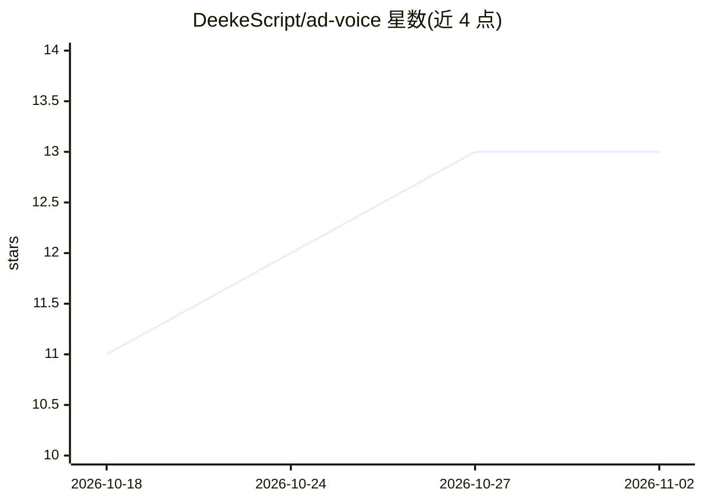

# DeekeScript/ad-voice

⭐ 13 · 推送 2026-07-17 · [GitHub](https://github.com/DeekeScript/ad-voice) · [官网](https://aiutter.cn) · 组织维护 · 中文 README

**面向私域销售的 AI 语音获客系统，覆盖微信/QQ/抖音/TikTok 等平台**

名为“语聊助手”的商业化 AI 语音获客系统：结合 LLM、声音克隆（约 10 秒录音创建音色）与真人级 TTS，自动生成回复并批量发送语音消息到微信、QQ、抖音、快手、TikTok、Telegram、WhatsApp 等平台，用于私域销售、AI 陪聊与社交运营。技术上包含 Flutter App、PHP Laravel 服务端、MySQL/Redis，带用户端（登录、AI 回复、音色库、VIP/套餐付费）与管理后台。README 声明项目仅用于商业合作展示，支持 OEM 贴牌、私有化部署与源码出售，未提供安装运行步骤。

## 筛选速览

| 维度 | 判定 | 备注 |
|---|---|---|
| AI 角色 | `ai-native` | 本体是模型或模型工具 |
| 许可风险 | `none` | — |
| 部署形态 | `None` |  |
| 模型依赖 | — | README 未给出锁定关系 |
| 硬件要求 | — | 无带数字的原话,不猜 |
| 安装摩擦 | `low` | 无编译、无系统依赖或容器化 |
| 成熟度 | — | 结构信号不足 |

## 能力要点

- 约 10 秒录音创建专属音色，支持中英文、多情绪语气
- 覆盖微信/QQ/抖音/快手/TikTok/Telegram/WhatsApp 多平台语音发送
- AI 自动回复 + 一键语音生成 + 上下文记忆 + 多角色切换
- 含用户端 App、管理后台与 VIP/套餐等 SaaS 商业化模块

## 适用场景

- 私域销售中用 AI 语音自动回复与成交客户
- AI 陪聊与情感聊天互动
- TikTok 等海外平台的社交互动触达
- 社群运营中批量发送语音激活潜在客户

## 场景标签

`语音合成` `聊天机器人` · 领域:对话与助手

## 证据(README 行号)

> L3: # 🎙️ 微信AI语音助手/抖音语音获客助手
> L35: # 🎙️ AI 语音获客系统
> L47: ✅ AI 自动批量发送微信语音消息

## 星数曲线

2026-10-18 11 → 2026-11-02 13（+2）

---
*卡片 v1 · prompt 1.4 · 生成 2026-10-31 · 置信度 high · 依据 README sha `34fa6b84ed8d` · [字段定义](../../DATASET.md)*
