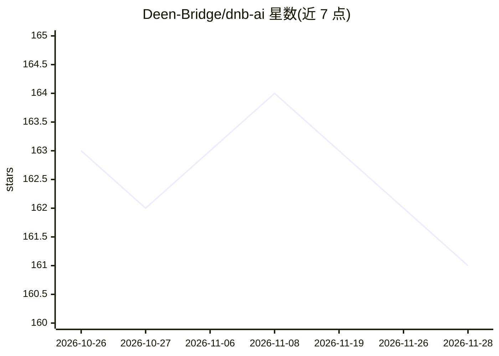

# Deen-Bridge/dnb-ai

⭐ 161 · Python · MIT · 推送 2026-11-24 · [GitHub](https://github.com/Deen-Bridge/dnb-ai) · 组织维护

**为 DeenBridge 平台提供带经文引用校验的伊斯兰知识 AI 问答服务**

Deen Bridge 平台的 AI 助手后端服务，基于 FastAPI 封装 Google Gemini 模型，配合伊斯兰知识系统提示词、内容安全过滤与会话历史。回答附带结构化经文引用，低置信度宗教问题转入学者人工复核队列；提供经注检索、圣训研究代理、诵经转录比对等端点。面向 Deen Bridge 前端应用消费，通过 API Key 鉴权，含请求速率与令牌配额限制。默认模型 gemini-1.5-flash，依赖 Python 3.11+ 与 Gemini API key。

## 筛选速览

| 维度 | 判定 | 备注 |
|---|---|---|
| AI 角色 | `ai-native` | 本体是模型或模型工具 |
| 许可风险 | `permissive` | MIT |
| 部署形态 | `self-host` | docker 或自建部署 |
| 模型依赖 | — | README 未给出锁定关系 |
| 硬件要求 | — | 无带数字的原话,不猜 |
| 安装摩擦 | `low` | 无编译、无系统依赖或容器化 |
| 成熟度 | — | 结构信号不足 |

## 能力要点

- 每个回答返回经过界校验的结构化《古兰经》/圣训引用对象
- 置信度感知回答：低于阈值弃答或转学者复核队列
- 用户长期记忆档案（学派、知识水平等）支持查询与删除端点
- Stellar 感知端点：USDC 天课估算与换算，仅离线解读、不签署交易

## 适用场景

- 为伊斯兰教育平台接入带引用校验的 AI 问答
- 对存疑宗教回答走学者人工审核流程
- 诵经转录与标准经文的逐词比对分析

## 场景标签

`聊天机器人` `RAG` · 领域:对话与助手

## 证据(README 行号)

> L3: **The FastAPI service behind Deen Bridge's Islamic-knowledge AI assistant, powered by Google Gemini.**
> L14: This service powers the AI assistant inside **Deen Bridge**, a platform for authentic Islamic education built on th
> L35: - 🎚️ **Confidence-aware answers** — abstains or hedges instead of guessing, and routes doubtful religious answers t

## 星数曲线

2026-10-26 163 → 2026-11-28 161（-2）

---
*卡片 v1 · prompt 1.4 · 生成 2026-11-27 · 置信度 high · 依据 README sha `9122a3fe8442` · [字段定义](../../DATASET.md)*
