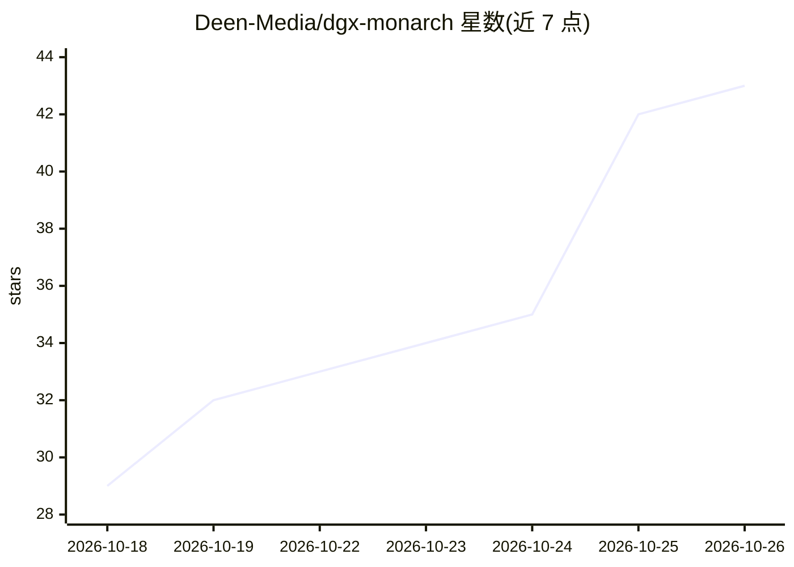

# Deen-Media/dgx-monarch

⭐ 43 · Python · Apache-2.0 · 推送 2026-10-24 · [GitHub](https://github.com/Deen-Media/dgx-monarch) · 组织维护

**在两台 DGX Spark 上分布式运行 ComfyUI 图像/视频生成**

面向拥有两台 NVIDIA DGX Spark 的 ComfyUI 用户的分布式生成工具：把一次图像或视频渲染拆分到两块 GPU、在两台机器上并行跑不同任务（Fleet）、或用 FSDP 分片受支持的模型权重以容纳更大 checkpoint。提供模型加载器、采样器、内存控制（slab residency、低 RSS LoRA）与 71 个示例工作流；文本编码、VAE 解码等仍留在 ComfyUI。以 custom_nodes 源码安装方式集成，附带 CLI（dgxm）、TUI 仪表盘与草稿状态的 Studio 浏览器工作台。要求现有 ComfyUI 安装与匹配的 CUDA torch 构建。

## 筛选速览

| 维度 | 判定 | 备注 |
|---|---|---|
| AI 角色 | `ai-ecosystem` | LLM/agent 周边工具 |
| 许可风险 | `permissive` | Apache-2.0 |
| 部署形态 | `None` |  |
| 模型依赖 | — | README 未给出锁定关系 |
| 硬件要求 | — | 无带数字的原话,不猜 |
| 安装摩擦 | `medium` | 含编译或系统依赖之一 |
| 成熟度 | `idea` | |

## 能力要点

- 单任务跨两 GPU 拆分渲染（Ulysses/cfg2 等）与双任务并行（Fleet）
- FSDP 权重分片容纳更大模型，slab residency 与低 RSS LoRA 减少重复显存占用
- 71 个示例工作流，覆盖 Krea2、MiniMax H3、Ideogram4、Qwen Image 2.1 等
- dgxm top / ComfyUI 侧栏显示内存、进度、连接状态；首用 Gate 自动对照单 GPU 结果校验

## 适用场景

- 我有两台 DGX Spark，想缩短 ComfyUI 图像或视频渲染时间
- 想在两块 GPU 上同时跑不同提示词的独立渲染任务
- 单个 Spark 显存放不下某个大模型，需要把权重分片到两台机器

## 场景标签

`图像生成` `视频生成` `推理引擎` · 领域:内容生成

## 证据(README 行号)

> L9: Generate images and video across two DGX Sparks from one ComfyUI window. Split a render between the GPUs, run separa
> L11: DGX Monarch provides model loaders, samplers, memory controls, and 71 example workflows. Text encoding, VAE decode,
> L198: DGX Monarch uses PyTorch Monarch for actors and xDiT / xfuser for parallel attention, inside ComfyUI. These depend

## 星数曲线

2026-10-18 29 → 2026-10-26 43（+14）

---
*卡片 v1 · prompt 1.4 · 生成 2026-10-25 · 置信度 high · 依据 README sha `d2d0ce56bff3` · [字段定义](../../DATASET.md)*
