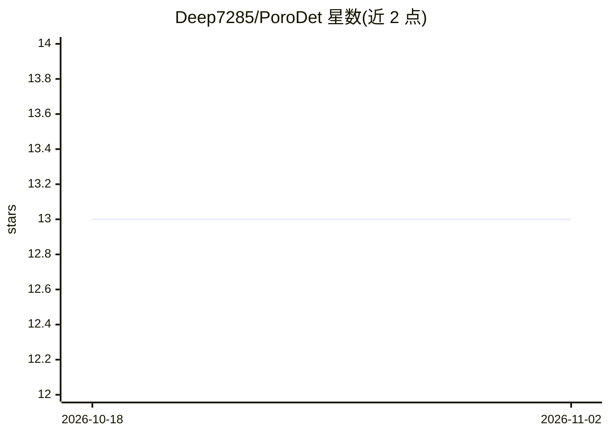

# Deep7285/PoroDet

⭐ 13 · Jupyter Notebook · MIT · 推送 2026-03-31 · [GitHub](https://github.com/Deep7285/PoroDet) · 组织维护

**材料科研者检测 TEM 图像纳米孔隙的 U-Net 分割工具**

Python 包 PoroDet：用 U-Net CNN 对 Fresnel 衬度透射电镜（TEM）图像做纳米孔隙与裂纹的分割与量化。当前实现针对锆合金氧化物，方法可迁移到其他材料。提供五个工具：数据增强、模型训练（K 折交叉验证，含 precision/recall/F1/IoU 等）、推理检测（输出概率图、掩膜、孔隙率统计）、后处理分析（按纵横比分类孔隙/裂纹）与微调（可冻结编码器）。通过 pip 从 GitHub 安装，支持 Colab 与本地 Jupyter 两种运行方式，操作经 GUI 触发。

## 筛选速览

| 维度 | 判定 | 备注 |
|---|---|---|
| AI 角色 | `ai-native` | 本体是模型或模型工具 |
| 许可风险 | `permissive` | MIT |
| 部署形态 | `library` | 以包/库形式分发 |
| 模型依赖 | — | README 未给出锁定关系 |
| 硬件要求 | — | 无带数字的原话,不猜 |
| 安装摩擦 | `low` | 无编译、无系统依赖或容器化 |
| 成熟度 | — | 结构信号不足 |

## 能力要点

- U-Net 分割 TEM 图像中的纳米孔隙与裂纹
- 训练含 K 折交叉验证并报告多种分割指标
- 推理输出概率图、二值掩膜及孔隙率（%）统计
- 后处理按纵横比阈值区分 nanopore 与 nanocrack
- 支持从预训练检查点微调（可冻结编码器）

## 适用场景

- 我对锆合金氧化物的 TEM 图像做纳米孔隙定量分析
- 我用小数据集微调预训练模型适配新材料
- 我需要区分图像中的孔隙与裂纹并输出统计直方图

## 场景标签

`科研工具` `目标检测` `微调` · 领域:学习与行业

## 证据(README 行号)

> L5: **PoroDet** is a Python package for the contrast-based detection and analysis of nanoporosities in Fresnel-contrast 
> L56: Trains a U-Net CNN on the image–mask pairs for pixel-wise nanopore segmentation.

## 星数曲线

2026-10-18 13 → 2026-11-02 13（+0）

---
*卡片 v1 · prompt 1.4 · 生成 2026-10-31 · 置信度 high · 依据 README sha `5d0aa2915277` · [字段定义](../../DATASET.md)*
