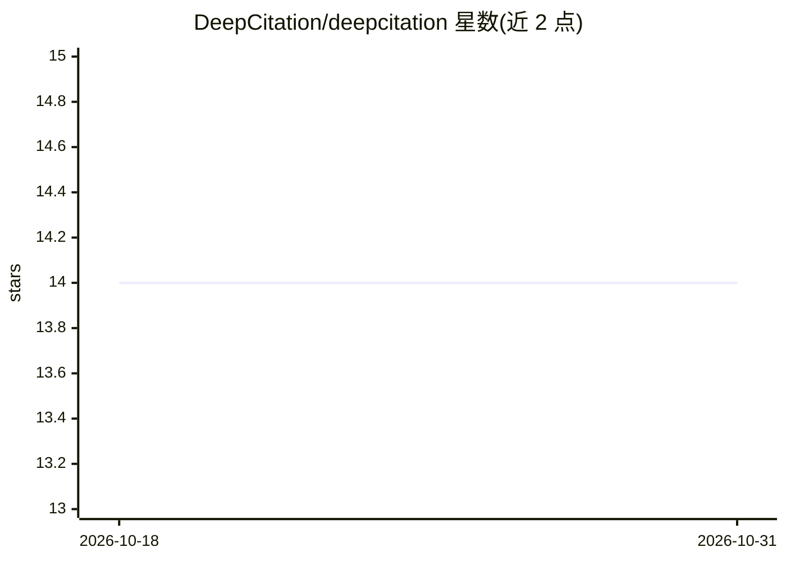

# DeepCitation/deepcitation

⭐ 14 · TypeScript · MIT · 推送 2026-09-07 · [GitHub](https://github.com/DeepCitation/deepcitation) · [官网](https://deepcitation.com) · 组织维护

**AI 引用验证库：核验模型引用并生成可视化证明**

面向开发者的引用验证层：将模型给出的引用转为确定性、可检查的证明，替代不可验证的引用。以 TypeScript 库（deepcitation，零依赖约 9KB）形式提供，包含 Citation、CitationDrawer 等 React 组件，处理多格式读取、坐标映射与可视化证明生成；亦可作为 Agent Skill 安装后用 Claude 执行 /verify。提供 Next.js AI SDK、LangChain RAG、Mastra 等多个示例工程，部分路径需要 DEEPCITATION_API_KEY。

## 筛选速览

| 维度 | 判定 | 备注 |
|---|---|---|
| AI 角色 | `ai-ecosystem` | LLM/agent 周边工具 |
| 许可风险 | `permissive` | MIT |
| 部署形态 | `desktop` | 安装包/桌面程序 |
| 模型依赖 | — | README 未给出锁定关系 |
| 硬件要求 | — | 无带数字的原话,不猜 |
| 安装摩擦 | `low` | 无编译、无系统依赖或容器化 |
| 成熟度 | — | 结构信号不足 |

## 能力要点

- 将模型引用转为确定性、可检查的证明
- 零依赖、约 9KB 的 npm 包
- Citation / CitationDrawer React 组件用于生产级归因系统
- 支持以 Agent Skill 形式安装并用 Claude 执行 /verify

## 适用场景

- 为聊天或 RAG 应用添加引用可视化与核验组件
- 让 Claude 通过 /verify 技能核验 AI 输出的声明
- 快速克隆 Next.js 示例在两分钟内跑通引用验证

## 场景标签

`LLM 可观测性` · 领域:评测与运维

## 证据(README 行号)

> L17: We believe AI citations should follow **show, don't tell**; they should prove their citations so you don't have to 
> L19: DeepCitation turns model citations into deterministic, inspectable proof.
> L58: A set of high-quality React components to help you build production-ready attribution systems. Skip the complexity 

## 星数曲线

2026-10-18 14 → 2026-10-31 14（+0）

---
*卡片 v1 · prompt 1.4 · 生成 2026-10-31 · 置信度 high · 依据 README sha `bc332954f2f5` · [字段定义](../../DATASET.md)*
