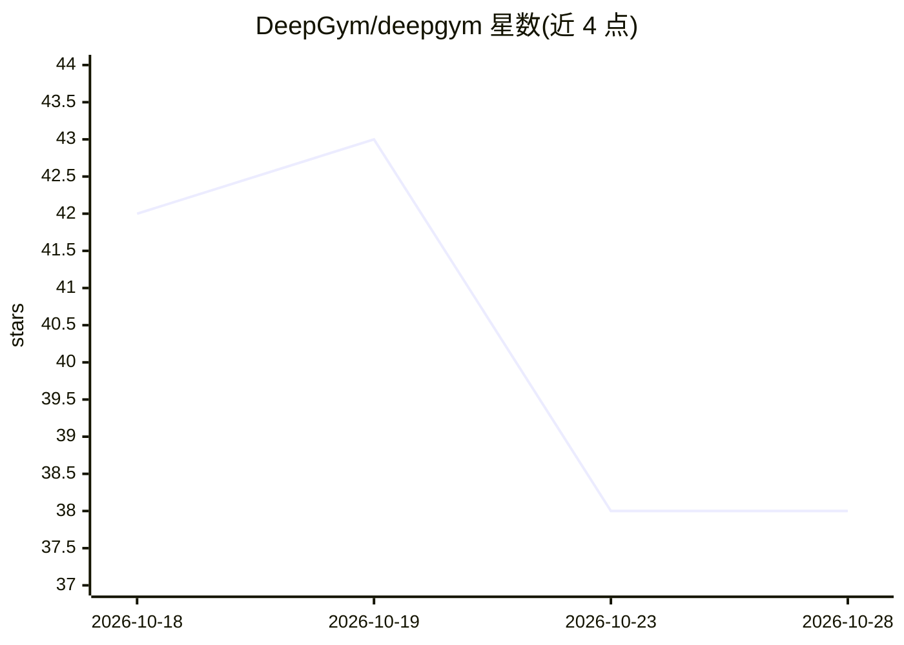

# DeepGym/deepgym

⭐ 38 · Python · NOASSERTION · 推送 2026-10-23 · [GitHub](https://github.com/DeepGym/deepgym) · [官网](https://deepgym.io) · 组织维护

**可验证奖励的 RL 环境库：沙箱运行答案并隔离校验**

为 LLM 强化学习训练提供带可验证奖励的环境：把模型产出（代码、补丁、shell 命令、桌面操作）放入沙箱（Docker/Daytona/Modal/E2B/Apple 容器）运行，由与答案隔离的校验器打分；基础设施失败不计入训练而非记 0，内置 QA 门检查 reward hacking。提供 31 个内置环境、HumanEval/SWE-bench Pro 等基准导入器、Claude Code/Codex/计算机使用 agent 框架，并集成 verl、TRL、OpenRLHF、Axolotl 与 lm-evaluation-harness。面向做 GRPO 等 RL 训练与评测的开发者，许可为 PolyForm Noncommercial。

## 筛选速览

| 维度 | 判定 | 备注 |
|---|---|---|
| AI 角色 | `ai-ecosystem` | LLM/agent 周边工具 |
| 许可风险 | `none` | NOASSERTION |
| 部署形态 | `self-host` | docker 或自建部署 |
| 模型依赖 | locked-api |  |
| 硬件要求 | — | 无带数字的原话,不猜 |
| 安装摩擦 | `low` | 无编译、无系统依赖或容器化 |
| 成熟度 | — | 结构信号不足 |

## 能力要点

- 沙箱隔离运行答案，校验器经 deepgym_solution 在无网络独立进程打分
- 基础设施失败返回无判定样本，训练集成可将其排除在训练外
- 31 个内置环境与 HumanEval/MBPP/SWE-bench Pro/Terminal-Bench 等基准导入器
- deepgym qa 检查参考通过、空答案与 reward hack 不给分，支持 --mutants

## 适用场景

- 为 GRPO 训练循环提供防 reward hacking 的可验证奖励
- 在 Docker 或云沙箱中评测模型生成的代码与补丁
- 把 SWE-bench Pro 等基准接入 verl/TRL/OpenRLHF 训练
- 评测计算机使用 agent 在锁定桌面上的任务完成状态

## 场景标签

`强化学习` `模型评测` · 领域:评测与运维

## 证据(README 行号)

> L9: DeepGym runs a model's answer (code, a patch, shell commands or desktop actions) in a
> L13: computer use, and plugs into verl, TRL, OpenRLHF, Axolotl or your own GRPO loop.
> L114: - **Trainer integrations:** [verl][verl] (reward function and agent loops), [TRL][trl],

## 星数曲线

2026-10-18 42 → 2026-10-28 38（-4）

---
*卡片 v1 · prompt 1.4 · 生成 2026-10-25 · 置信度 mid · 依据 README sha `a7879640e66b` · [字段定义](../../DATASET.md)*
