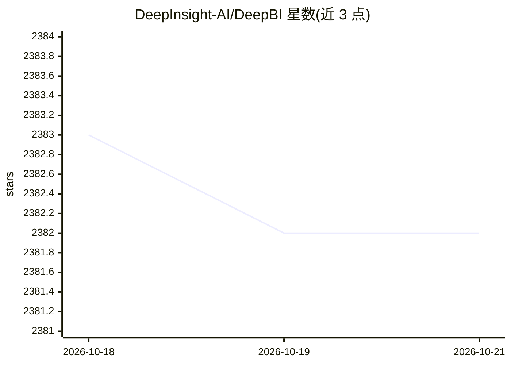

# DeepInsight-AI/DeepBI

⭐ 2,382 · Python · MIT · 推送 2026-08-28 · [GitHub](https://github.com/DeepInsight-AI/DeepBI) · [官网](https://www.deepbi.com/) · 组织维护 · 中文 README

**面向数据决策者的对话式 AI 数据分析（BI）平台**

DeepBI 是 AI 原生数据分析平台：借助大语言模型，用户通过对话获取任意数据结果与分析结论、生成持久化查询与可视化，并可组装成仪表盘；支持 MySQL、PostgreSQL、MongoDB、Doris、StarRocks 及 CSV/Excel 导入等多种数据源。提供 Windows exe 安装包、Docker 一键部署（端口 8338/8339）与 Ubuntu 源码安装三种方式，中英文双语界面；自动化数据分析报告功能标注为待开发。

## 筛选速览

| 维度 | 判定 | 备注 |
|---|---|---|
| AI 角色 | `ai-native` | 本体是模型或模型工具 |
| 许可风险 | `permissive` | MIT |
| 部署形态 | `desktop` | 安装包/桌面程序 |
| 模型依赖 | — | README 未给出锁定关系 |
| 硬件要求 | — | 无带数字的原话,不猜 |
| 安装摩擦 | `low` | 无编译、无系统依赖或容器化 |
| 成熟度 | — | 结构信号不足 |

## 能力要点

- 对话式数据分析与查询生成，产出持久化可视化
- 仪表盘组装持久化可视化组件
- 支持 MySQL/PostgreSQL/MongoDB/Doris/StarRocks/CSV/Excel 多数据源
- Windows exe、Docker、Ubuntu 源码三种安装方式，中英文双语

## 适用场景

- 通过对话直接查询数据库并获得可视化结果
- 将常用分析固化为仪表盘供团队查看
- 导入 CSV/Excel 文件做对话式分析

## 场景标签

`数据分析` · 领域:效率与自动化

## 证据(README 行号)

> L3: DeepBI is an AI-native data analysis platform. DeepBI leverages the power of large language models to explore, query
> L19: 1 Conversational data analysis: Users can get arbitrary data results and analysis results through dialogues.\

## 星数曲线

2026-10-18 2,383 → 2026-10-21 2,382（-1）

---
*卡片 v1 · prompt 1.4 · 生成 2026-10-21 · 置信度 high · 依据 README sha `76b8f2d1b1ff` · [字段定义](../../DATASET.md)*
