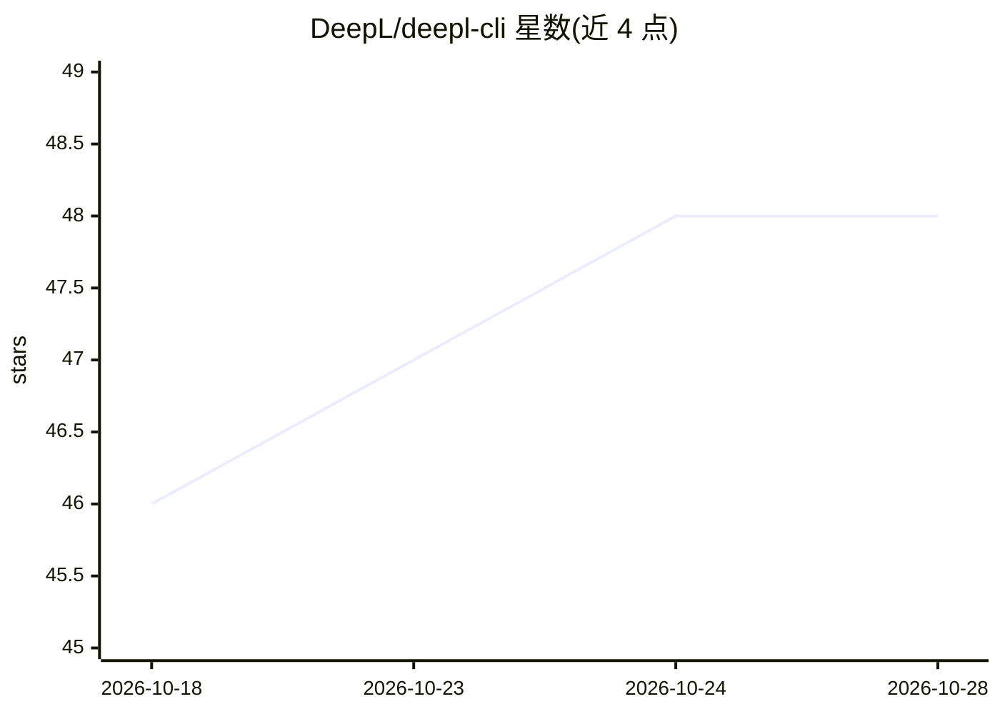

# DeepL/deepl-cli

⭐ 48 · TypeScript · MIT · 推送 2026-10-20 · [GitHub](https://github.com/DeepL/deepl-cli) · [官网](https://www.deepl.com) · 组织维护

**面向开发者的 DeepL 翻译/写作 API 命令行客户端**

DeepL 官方用 TypeScript 编写的 CLI 工具，封装 DeepL 翻译、Write 与 Voice API：支持文本与文档翻译（PDF/DOCX/PPTX 等格式，保留排版，上限 30MB）、增量 i18n 文件同步（11 种格式解析器）、监听模式自动翻译、语法风格润色、术语表与翻译记忆管理、SQLite 本地缓存及计费字符统计。需自备 DeepL API key；语音翻译与风格规则功能要求 Pro/Enterprise 账户。提供 Homebrew、npm 全局安装与源码构建三种途径，要求 Node.js 24.15.0+。

## 筛选速览

| 维度 | 判定 | 备注 |
|---|---|---|
| AI 角色 | `ai-ecosystem` | LLM/agent 周边工具 |
| 许可风险 | `permissive` | MIT |
| 部署形态 | `library` | 以包/库形式分发 |
| 模型依赖 | — | README 未给出锁定关系 |
| 硬件要求 | — | 无带数字的原话,不猜 |
| 安装摩擦 | `low` | 无编译、无系统依赖或容器化 |
| 成熟度 | — | 结构信号不足 |

## 能力要点

- 文本/文档翻译覆盖 PDF、DOCX、PPTX、XLSX、图片等格式并保留排版
- deepl sync 增量同步 11 种 i18n 文件格式，支持监听模式自动翻译
- 术语表（v3 API）与翻译记忆复用已批准译文
- SQLite 本地缓存、批量并行处理（每请求最多 50 条文本）、计费字符统计

## 适用场景

- 在脚本或 CI/CD 流水线中批量翻译文档与 i18n 文件
- 本地化工作流中增量同步多语言 JSON/YAML 文件
- 命令行快速翻译文本并利用缓存减少 API 调用

## 场景标签

`工作流自动化` · 领域:效率与自动化

## 证据(README 行号)

> L8: **DeepL CLI** is a comprehensive, developer-friendly command-line tool that integrates DeepL's powerful translation 
> L15: - **🎙️ Voice Translation (Pro/Enterprise)** - Real-time speech translation via WebSocket streaming (Voice API)

## 星数曲线

2026-10-18 46 → 2026-10-28 48（+2）

---
*卡片 v1 · prompt 1.4 · 生成 2026-10-25 · 置信度 high · 依据 README sha `ffaa699aca67` · [字段定义](../../DATASET.md)*
