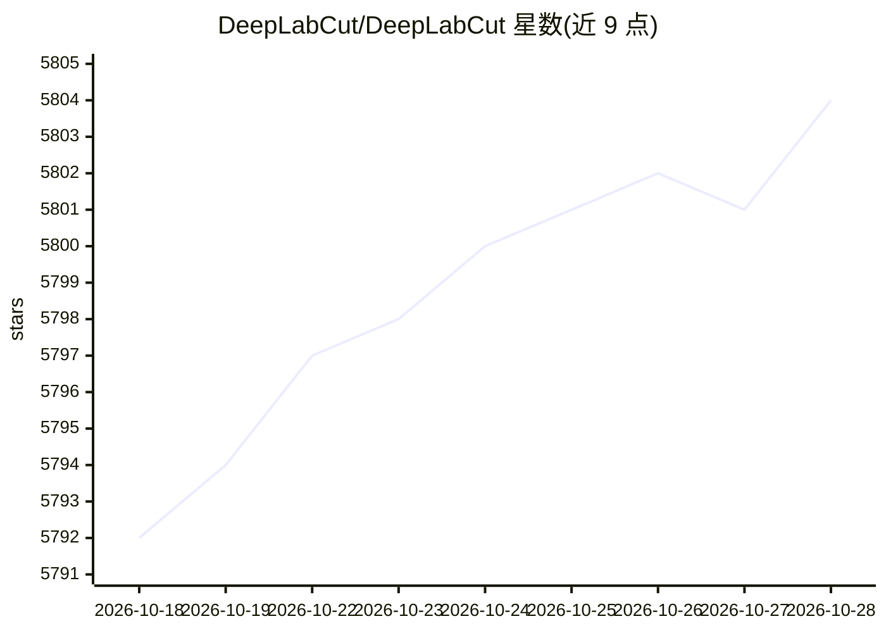

# DeepLabCut/DeepLabCut

⭐ 5,807 · Python · LGPL-3.0 · 推送 2026-10-27 · [GitHub](https://github.com/DeepLabCut/DeepLabCut) · [官网](http://deeplabcut.org) · 组织维护

**面向动物行为学研究的无标记姿态估计工具箱**

基于深度学习的无标记姿态估计 Python 工具箱，供计算机视觉研究者和生命科学家对动物（含人类）行为视频做自定义关键点的标注、训练、推理与追踪。v3.0 起后端支持 PyTorch（同时保留 TensorFlow 引擎），提供 GUI 与 API 两种使用方式，内置 Model Zoo 预训练模型（SuperAnimal-Quadruped、SuperAnimal-TopViewMouse 等），支持多动物识别与追踪、3D 姿态估计和实时包 DLC-live。许可为 LGPL v3，需 Python 3.10+。

## 筛选速览

| 维度 | 判定 | 备注 |
|---|---|---|
| AI 角色 | `ai-native` | 本体是模型或模型工具 |
| 许可风险 | `viral` | LGPL-3.0 |
| 部署形态 | `library` | 以包/库形式分发 |
| 模型依赖 | — | README 未给出锁定关系 |
| 硬件要求 | — | 无带数字的原话,不猜 |
| 安装摩擦 | `medium` | 含编译或系统依赖之一 |
| 成熟度 | — | 结构信号不足 |

## 能力要点

- 用户自定义关键点的无标记姿态估计，动物与物体无关
- 提供 GUI 与 API，PyTorch/TensorFlow 双引擎
- Model Zoo 内置 SuperAnimal 等预训练模型
- 支持多动物姿态估计、重识别与 3D 姿态估计

## 适用场景

- 实验室对小鼠等动物行为视频做关键点追踪
- 野外多物种动物行为分析
- 从标注数据到自动行为分析的完整工作流
- 使用预训练模型开箱即做动物姿态估计

## 场景标签

 · 领域:计算机视觉/动物行为分析

## 证据(README 行号)

> L30: **DeepLabCut™️** is a toolbox for state-of-the-art markerless pose estimation of animals performing various behavio
> L72: DeepLabCut continues to be actively maintained and we strive to provide a user-friendly `GUI` and `API` for compute

## 星数曲线

2026-10-18 5,792 → 2026-10-28 5,804（+12）

---
*卡片 v1 · prompt 1.4 · 生成 2026-10-20 · 置信度 high · 依据 README sha `9eabc0d411e8` · [字段定义](../../DATASET.md)*
