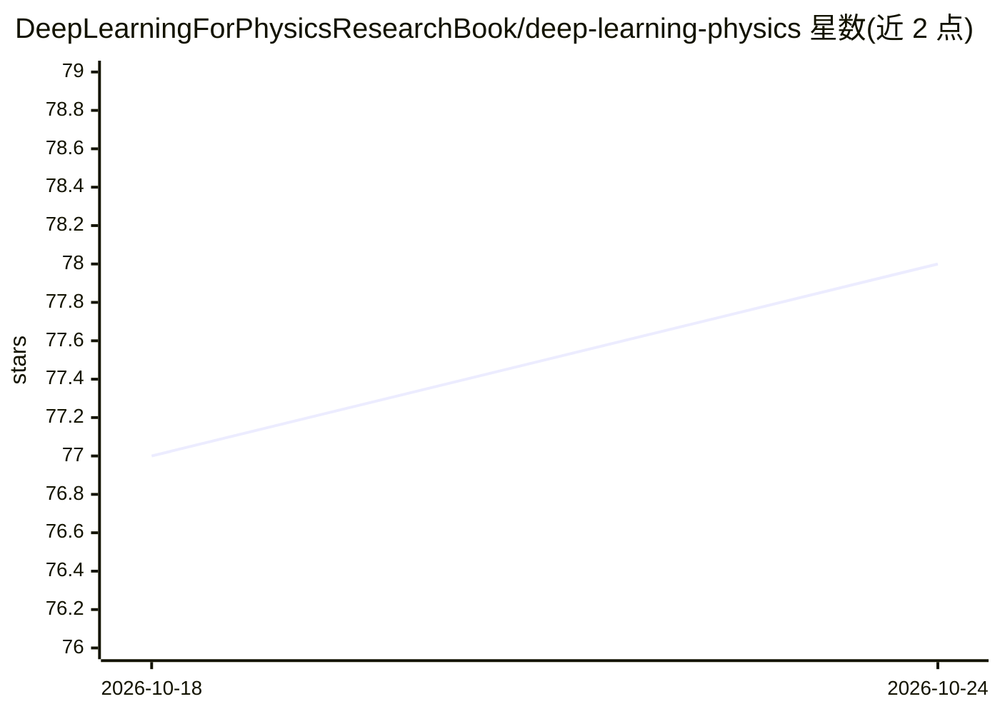

# DeepLearningForPhysicsResearchBook/deep-learning-physics

⭐ 78 · Jupyter Notebook · NOASSERTION · 推送 2026-03-06 · [GitHub](https://github.com/DeepLearningForPhysicsResearchBook/deep-learning-physics) · [官网](http://www.deeplearningphysics.org/) · 组织维护

**物理研究深度学习教材的配套习题仓库**

为教材《Deep Learning for Physics Research》（Erdmann 等著）提供配套练习材料：习题页面托管于 deeplearningphysics.org，可经 Colab、Binder 或 CERN SWAN 直接在线打开运行。练习基于 Keras 与 TensorFlow v2.4.0，下载仓库后可通过 pip install -r requirements.txt 安装依赖。内容以 CC BY-NC 4.0 许可发布，面向教材读者与物理研究者。

## 筛选速览

| 维度 | 判定 | 备注 |
|---|---|---|
| AI 角色 | `ai-knowledge` | 知识聚合/清单类 |
| 许可风险 | `none` | NOASSERTION |
| 部署形态 | `library` | 以包/库形式分发 |
| 模型依赖 | — | README 未给出锁定关系 |
| 硬件要求 | — | 无带数字的原话,不猜 |
| 安装摩擦 | `low` | 无编译、无系统依赖或容器化 |
| 成熟度 | — | 结构信号不足 |

## 能力要点

- 教材配套习题集，含在线运行入口
- 支持 Colab / Binder / CERN SWAN 三种在线运行方式
- 基于 Keras 与 TensorFlow v2.4.0

## 适用场景

- 配合教材章节做深度学习练习
- 在 Colab 或 SWAN 上直接运行习题笔记本
- 物理研究者入门机器学习工具链

## 场景标签

`教程课程` · 领域:学习与行业

## 证据(README 行号)

> L3: This repository contains additional material (exercises) for the textbook *Deep Learning for Physics Research* by
> L22: The exercises are based on Keras and TensorFlow v2.4.0.

## 星数曲线

2026-10-18 77 → 2026-10-24 78（+1）

---
*卡片 v1 · prompt 1.4 · 生成 2026-10-24 · 置信度 high · 依据 README sha `4b6adf7249a9` · [字段定义](../../DATASET.md)*
