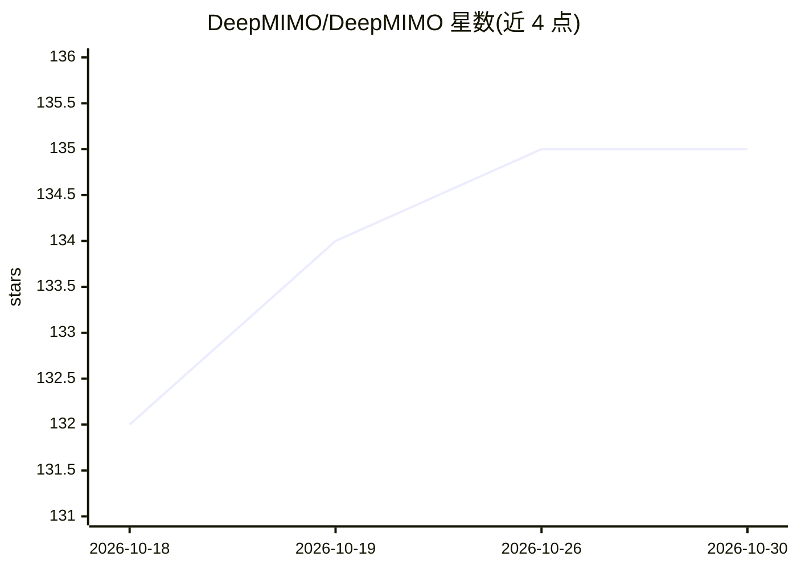

# DeepMIMO/DeepMIMO

⭐ 135 · Python · Apache-2.0 · 推送 2026-10-28 · [GitHub](https://github.com/DeepMIMO/DeepMIMO) · [官网](https://deepmimo.net/) · 组织维护

**无线信道射线追踪数据集与工具链，衔接 5G/6G 仿真与 AI 基准测试**

DeepMIMO 提供 Python 工具链与场景数据库：将 Wireless InSite、Sionna RT、AODT 等射线追踪器的输出转换为标准化、可分发、带版本的场景数据集，供 Sionna、MATLAB 5G Toolbox、NeoRadium 等仿真工具读取；用户用少量代码即可下载并加载数百个站点级信道数据集。定位为非仿真器的标准化工具链，依赖并补充 Sionna RT 等工具，服务 AI 驱动的无线研究可复现基准测试。通过 PyPI 安装，需 Python 3.11+。

## 筛选速览

| 维度 | 判定 | 备注 |
|---|---|---|
| AI 角色 | `ai-knowledge` | 知识聚合/清单类 |
| 许可风险 | `permissive` | Apache-2.0 |
| 部署形态 | `library` | 以包/库形式分发 |
| 模型依赖 | — | README 未给出锁定关系 |
| 硬件要求 | — | 无带数字的原话,不猜 |
| 安装摩擦 | `low` | 无编译、无系统依赖或容器化 |
| 成熟度 | — | 结构信号不足 |

## 能力要点

- 将 InSite/Sionna RT/AODT 射线追踪输出转换为标准化可分发数据集
- 数百个站点级场景数据库，数秒至数分钟完成下载加载
- 兼容 Sionna、MATLAB 5G Toolbox、NeoRadium 等仿真工具
- 提供按主题/应用检索论文的 Publications Database 与 Notebook 教程

## 适用场景

- 下载站点级信道数据集做 5G/6G AI 模型训练与基准测试
- 把自研射线追踪仿真结果转换为可分享、可复现的标准格式
- 跨项目复现他人论文使用的信道数据

## 场景标签

 · 领域:无线通信/科研数据集

## 证据(README 行号)

> L24:  Enable large‑scale AI benchmarking using site‑specific wireless ray‑tracing datasets.
> L25:  Convert outputs from top propagation ray tracers into a clean, distributable format readable by modern simulation 
> L31: - 🧪 **Easy ML benchmarking across sites** — Find 100s of datasets in the Scenarios Database

## 星数曲线

2026-10-18 132 → 2026-10-30 135（+3）

---
*卡片 v1 · prompt 1.4 · 生成 2026-10-22 · 置信度 high · 依据 README sha `b5c98534530b` · [字段定义](../../DATASET.md)*
