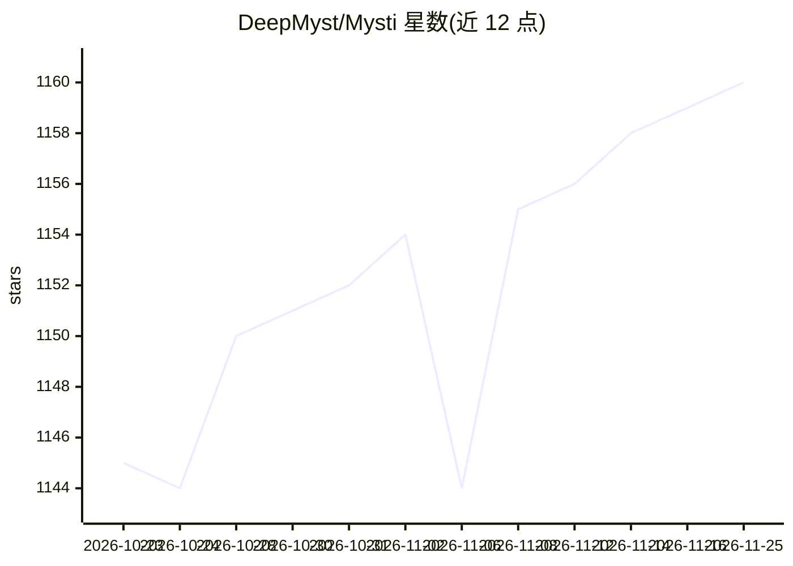

# DeepMyst/Mysti

⭐ 1,160 · TypeScript · Apache-2.0 · 推送 2026-11-10 · [GitHub](https://github.com/DeepMyst/Mysti) · [官网](https://www.deepmyst.com) · 组织维护

**VS Code 多编码 agent 协作扩展：多 agent 讨论、交接与综合**

一个 Apache-2.0 的 VS Code 扩展（Beta 2，要求 VS Code 1.86+），把 Claude Code、OpenAI Codex 等 16 个 provider 适配器接入同一对话流：可在一条消息中 @ 多个 agent 获取独立回答、让第二个 agent 以第一个的完成结果为上下文做审查、通过 Quick/Debate/Red Team/Delphi 等策略运行 Brainstorm 决策讨论。提供文件/诊断/Git 上下文注入、Canvas 可视化、检查点恢复与审批控制；模型订阅与 API 费用需用户自备。

## 筛选速览

| 维度 | 判定 | 备注 |
|---|---|---|
| AI 角色 | `ai-ecosystem` | LLM/agent 周边工具 |
| 许可风险 | `permissive` | Apache-2.0 |
| 部署形态 | `None` |  |
| 模型依赖 | local-ok | 支持本地模型 |
| 硬件要求 | — | 无带数字的原话,不猜 |
| 安装摩擦 | `low` | 无编译、无系统依赖或容器化 |
| 成熟度 | `idea` | |

## 能力要点

- 一条消息可 @ 多个 agent 并行获取独立回答
- agent 间显式交接：实现后由另一 agent 以结果为上下文审查
- Brainstorm 提供 Quick/Debate/Red Team/Perspectives/Delphi 五种讨论策略
- 16 个 provider 适配器，含 Ollama/LocalAI 本地模型路径

## 适用场景

- 让两个编码 agent 独立给出方案再综合取舍
- 实现完成后交给另一个 agent 做边界情况审查
- 在 VS Code 内用本地模型（Ollama）参与编码对话

## 场景标签

`多智能体` `编码 Agent` · 领域:Agent 开发

## 证据(README 行号)

> L18: ### Your coding agents. One shared workflow.
> L42: - **Keep your preferred tools.** Choose among 16 provider adapters, or use the Mysti coordinator. Each provider kee
> L170: Mysti includes **16 provider adapters plus the Mysti coordinator**. Start with the tools you already use, then con

## 星数曲线

2026-10-23 1,145 → 2026-11-25 1,160（+15）

---
*卡片 v1 · prompt 1.4 · 生成 2026-11-24 · 置信度 high · 依据 README sha `77f4658e7e9f` · [字段定义](../../DATASET.md)*
