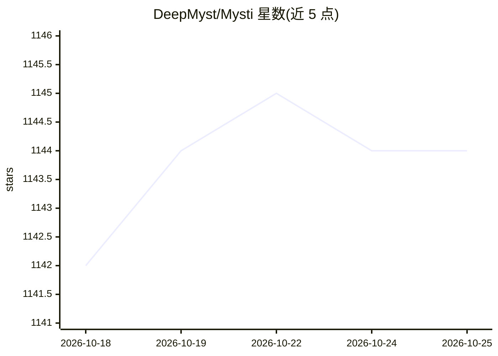

# DeepMyst/Mysti

⭐ 1,144 · TypeScript · Apache-2.0 · 推送 2026-10-13 · [GitHub](https://github.com/DeepMyst/Mysti) · [官网](https://www.deepmyst.com) · 组织维护

**VS Code 多智能体编码工作区：让 Claude Code、Codex 等协作**

VS Code 扩展，把多个编码 agent（Claude Code、OpenAI Codex 等 CLI agent、本地模型服务与 API 端点，共 16 个 provider 适配器）聚合到同一对话界面：用 @标签 指派任务、并行征求独立意见、用 then 做跨 agent 依赖交接，Brainstorm 模式让两个 agent 按 Debate/Red Team 等策略讨论并综合结论。还提供 Composio/Smithery 工具连接、Proactive 上下文收集、检查点与审批控制。2.0 处于 BETA 预发布阶段。面向使用多种编码 agent 的开发者。

## 筛选速览

| 维度 | 判定 | 备注 |
|---|---|---|
| AI 角色 | `ai-ecosystem` | LLM/agent 周边工具 |
| 许可风险 | `permissive` | Apache-2.0 |
| 部署形态 | `None` |  |
| 模型依赖 | local-ok | 支持本地模型 |
| 硬件要求 | — | 无带数字的原话,不猜 |
| 安装摩擦 | `low` | 无编译、无系统依赖或容器化 |
| 成熟度 | `idea` | |

## 能力要点

- 16 个 provider 适配器接入编码 CLI、本地模型服务与 API 端点
- @标签 并行/依赖式多 agent 任务指派与跨 agent 交接
- Brainstorm 提供 Debate/Red Team/Perspectives/Delphi 等讨论与综合策略
- 通过 DeepMyst 的 Composio/Smithery 目录连接外部工具与 MCP 服务器

## 适用场景

- 让 Claude Code 与 Codex 对同一问题给出可对比的独立意见
- 按顺序把一个 agent 的产出交给另一个 agent 审查
- 在 VS Code 内统一管理多个编码 agent 的上下文、权限与进度

## 场景标签

`多智能体` `编码 Agent` · 领域:Agent 开发

## 证据(README 行号)

> L10: **An open-source coding workspace that brings your agents together inside VS Code.**
> L12: Ask Claude Code and Codex for independent opinions. Give a specialist a specific task. Hand completed work to anoth
> L140: |Local / API endpoints|Ollama, LocalAI, OpenRouter, MiniMax|

## 星数曲线

2026-10-18 1,142 → 2026-10-25 1,144（+2）

---
*卡片 v1 · prompt 1.4 · 生成 2026-10-21 · 置信度 high · 依据 README sha `4ba3ce87aefb` · [字段定义](../../DATASET.md)*
