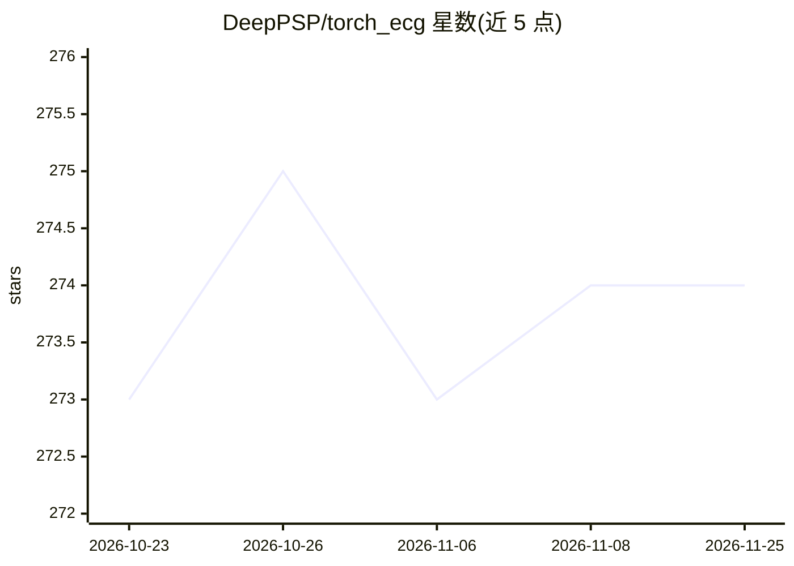

# DeepPSP/torch_ecg

⭐ 274 · Python · MIT · 推送 2026-11-23 · [GitHub](https://github.com/DeepPSP/torch_ecg) · 个人维护

**给心电图研究者/开发者的 PyTorch 深度学习框架**

基于 PyTorch 的心电图深度学习框架，提供数据增强器、预处理器、14 个 PhysioNet/CPSC 等来源数据库的读取类、多种网络架构（CRNN、U-Net、RR-LSTM）及 VGG/ResNet/DenseNet 等 CNN 骨干，并内置日志器、输出容器、指标计算与抽象训练器。任务覆盖分类、序列标注、波形轮廓划分与 R 峰检测。通过 pip 安装，benchmarks 文件夹提供可复用的训练示例，文档尚在开发中，测试流程待完善。

## 筛选速览

| 维度 | 判定 | 备注 |
|---|---|---|
| AI 角色 | `ai-native` | 本体是模型或模型工具 |
| 许可风险 | `permissive` | MIT |
| 部署形态 | `library` | 以包/库形式分发 |
| 模型依赖 | — | README 未给出锁定关系 |
| 硬件要求 | — | 无带数字的原话,不猜 |
| 安装摩擦 | `low` | 无编译、无系统依赖或容器化 |
| 成熟度 | — | 结构信号不足 |

## 能力要点

- 内置 14 个 ECG 数据库的读取类与配套 Dataset
- 支持 CRNN/U-Net/RR-LSTM 与多种 CNN 骨干，可自定义模型配置
- 统一管理的数据增强器（mixup、cutmix 等 8 种）与预处理器
- 内置分类/R峰检测/波形划分指标与抽象训练器

## 适用场景

- 训练 12 导联心电图分类模型（如 NSR/AF/PVC/SPB）
- 复现 PhysioNet Computing in Cardiology 竞赛基线
- 读取并管理 PhysioNet/CPSC 数据库的 ECG 记录与标注
- 构建 QRS 检测或波形划分的训练流水线

## 场景标签

`模型训练` `科研工具` · 领域:学习与行业

## 证据(README 行号)

> L13: ECG Deep Learning Framework Implemented using PyTorch.
> L150: 1. CRNN, both for classification and sequence tagging (segmentation)
> L273: - `ClassificationOutput`

## 星数曲线

2026-10-23 273 → 2026-11-25 274（+1）

---
*卡片 v1 · prompt 1.4 · 生成 2026-11-25 · 置信度 high · 依据 README sha `d3fcab7ef31c` · [字段定义](../../DATASET.md)*
