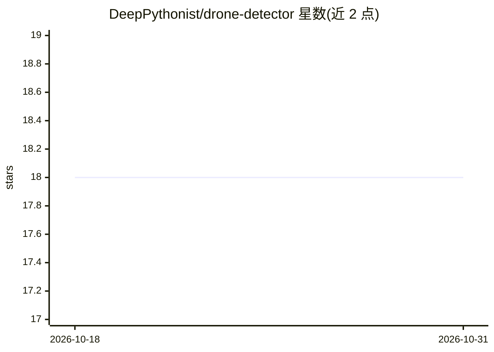

# DeepPythonist/drone-detector

⭐ 18 · MIT · 推送 2025-11-11 · [GitHub](https://github.com/DeepPythonist/drone-detector) · [官网](https://github.com/DeepPythonist/drone-detector) · 个人维护

**YOLOv8 无人机检测模型：识别四类空中目标**

基于 YOLOv8 的目标检测模型，可检测 Drone、Bird、UAV、Airplane 四个类别。作者在 2025 年 6 月为期 12 天的伊朗-以色列冲突后开发，用于空中威胁监测场景，包括早期发现、区分鸟类与飞行器、支持反无人机响应。README 报告 mAP50 为 96.1%、Precision 与 Recall 各 94.1%。使用方式为通过 ultralytics 库加载模型权重，安装仅需 pip install ultralytics。

## 筛选速览

| 维度 | 判定 | 备注 |
|---|---|---|
| AI 角色 | `ai-native` | 本体是模型或模型工具 |
| 许可风险 | `permissive` | MIT |
| 部署形态 | `library` | 以包/库形式分发 |
| 模型依赖 | — | README 未给出锁定关系 |
| 硬件要求 | — | 无带数字的原话,不猜 |
| 安装摩擦 | `low` | 无编译、无系统依赖或容器化 |
| 成熟度 | — | 结构信号不足 |

## 能力要点

- 检测 Drone/Bird/UAV/Airplane 四个类别
- 报告 mAP50 96.1%、mAP50-95 67.4%
- 基于 YOLOv8，通过 ultralytics 库加载使用

## 适用场景

- 对空域画面进行无人机与飞行器检测
- 区分鸟类与无人机以减少误报
- 关键设施周边的空中目标监测

## 场景标签

`目标检测` · 领域:感知与多模态

## 证据(README 行号)

> L3: High-precision YOLOv8 model for detecting drones, UAVs, birds, and airplanes with **96.1% mAP50** accuracy.
> L34: from ultralytics import YOLO

## 星数曲线

2026-10-18 18 → 2026-10-31 18（+0）

---
*卡片 v1 · prompt 1.4 · 生成 2026-10-29 · 置信度 high · 依据 README sha `215ff50d1377` · [字段定义](../../DATASET.md)*
