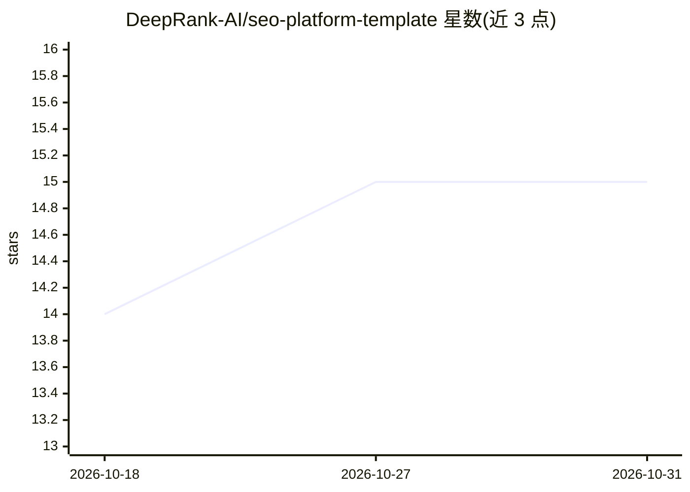

# DeepRank-AI/seo-platform-template

⭐ 15 · Vue · MIT · 推送 2025-11-07 · [GitHub](https://github.com/DeepRank-AI/seo-platform-template) · [官网](https://deeprankai.com) · 组织维护

**Nuxt 3 编写的 SEO 平台前端模板（仪表盘+落地页）**

基于 Vue 3 / Nuxt 3 / Tailwind CSS 的 SEO SaaS 平台完整模板，含落地页与仪表盘：域流量分析、流量分析、关键词研究、页面 SEO 优化建议、反链工具、站点审计等模块，并集成 Google Search Console 与 OpenAI API，AI 用于数据采集、竞品分析与关键词预测等。安装方式为 git clone 后 npm install 并 npm run dev 启动。MIT 许可，关联 DeepRankAI 的在线服务与文档站点。

## 筛选速览

| 维度 | 判定 | 备注 |
|---|---|---|
| AI 角色 | `ai-ecosystem` | LLM/agent 周边工具 |
| 许可风险 | `permissive` | MIT |
| 部署形态 | `library` | 以包/库形式分发 |
| 模型依赖 | — | README 未给出锁定关系 |
| 硬件要求 | — | 无带数字的原话,不猜 |
| 安装摩擦 | `low` | 无编译、无系统依赖或容器化 |
| 成熟度 | — | 结构信号不足 |

## 能力要点

- 落地页 + SEO 仪表盘完整模板（Vue 3 / Nuxt 3 / Tailwind CSS）
- 覆盖关键词研究、反链分析、流量分析、站点审计模块
- API 集成 Google Search Console 与 OpenAI
- 动态 sitemap 生成与 SEO 优化

## 适用场景

- 搭建 SEO SaaS 平台的前端界面
- 快速获得含仪表盘与落地页的 SEO 工具站原型
- 接入 Google Search Console 数据做流量与关键词分析

## 场景标签

 · 领域:SEO/网页开发模板

## 证据(README 行号)

> L24: - **AI Tools**: Utilize AI for data collection, competitive analysis, keyword forecasting, and more.
> L26: - **API Integration** Google Search Console, OpenAI

## 星数曲线

2026-10-18 14 → 2026-10-31 15（+1）

---
*卡片 v1 · prompt 1.4 · 生成 2026-10-31 · 置信度 mid · 依据 README sha `ec2000fb7cff` · [字段定义](../../DATASET.md)*
