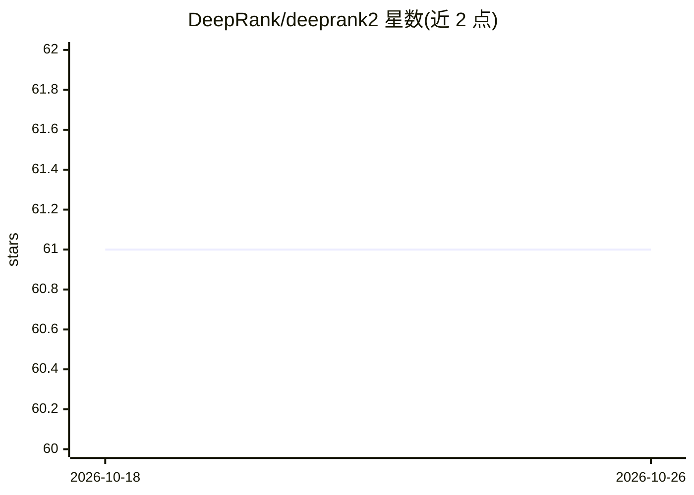

# DeepRank/deeprank2

⭐ 61 · Python · Apache-2.0 · 推送 2026-10-17 · [GitHub](https://github.com/DeepRank/deeprank2) · [官网](https://deeprank2.readthedocs.io/en/latest/?badge=latest) · 组织维护

**蛋白质界面与点突变数据挖掘的深度学习框架**

面向结构生物学研究的开源深度学习框架，整合自 DeepRank、DeepRank-GNN 与 DeepRank-Mut 三个前代包。读取 PDB 格式原子结构，映射为残基级或原子级图（也可转 3D 网格），计算理化与几何特征，支持蛋白质-蛋白质界面与单残基变异两类查询；内置基于 PyTorch/PyG 的 CNN/GNN 训练管线，数据以 HDF5 存储，支持分类与回归。提供 Docker 镜像、conda YML 与 pip 手动安装三种途径；本地安装正式支持最新 Ubuntu，需 GCC，CUDA 为可选项。

## 筛选速览

| 维度 | 判定 | 备注 |
|---|---|---|
| AI 角色 | `ai-native` | 本体是模型或模型工具 |
| 许可风险 | `permissive` | Apache-2.0 |
| 部署形态 | `self-host` | docker 或自建部署 |
| 模型依赖 | — | README 未给出锁定关系 |
| 硬件要求 | — | 无带数字的原话,不猜 |
| 安装摩擦 | `low` | 无编译、无系统依赖或容器化 |
| 成熟度 | — | 结构信号不足 |

## 能力要点

- PDB 结构到图/3D 网格的映射与预定义理化几何特征
- PPI 与 SRV 两类查询（ProteinProteinInterfaceQuery / SingleResidueVariantQuery）
- 基于 PyTorch/PyG 的 CNN/GNN 训练管线，支持分类与回归
- 数据以 HDF5 格式存储，提供预构建 Docker 镜像与教程 notebook

## 适用场景

- 挖掘蛋白质复合物中的界面相互作用模式
- 预测蛋白质结构中错义变异的突变表型
- 用自己的特征与目标定义定制训练数据集

## 场景标签

 · 领域:结构生物学/深度学习

## 证据(README 行号)

> L14: DeepRank2 is an open-source deep learning (DL) framework for data mining of protein-protein interfaces (PPIs) or si
> L21: The physico-chemical and geometrical features are then computed and assigned to each node and edge. The user can ch
> L34: - Support for both classification and regression (based on PyTorch and PyTorch Geometric)

## 星数曲线

2026-10-18 61 → 2026-10-26 61（+0）

---
*卡片 v1 · prompt 1.4 · 生成 2026-10-24 · 置信度 high · 依据 README sha `8a0b4ab06643` · [字段定义](../../DATASET.md)*
