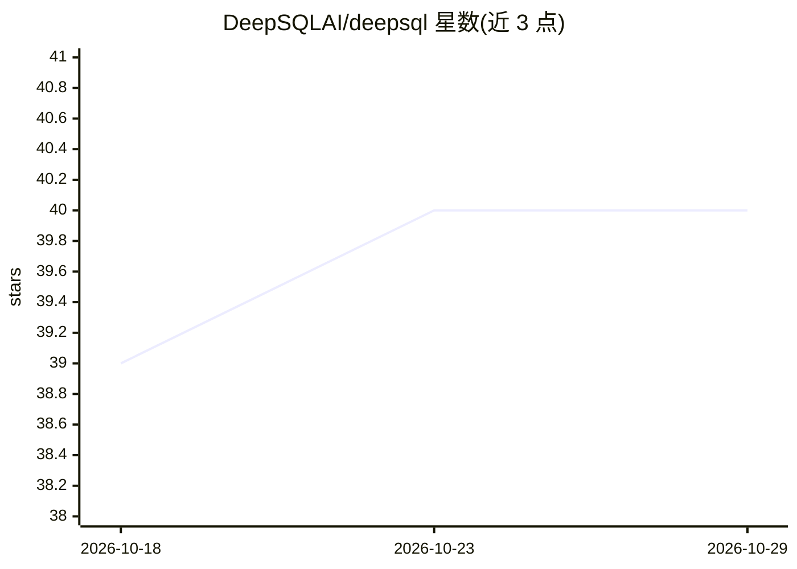

# DeepSQLAI/deepsql

⭐ 40 · Java · Apache-2.0 · 推送 2026-10-28 · [GitHub](https://github.com/DeepSQLAI/deepsql) · [官网](https://deepsql.ai/) · 组织维护

**面向 Postgres/MySQL 的自托管数据库 AI 代理：自然语言问答、慢查询分析、索引建议**

自托管的数据库代理，用户以自然语言提问，系统解析 schema、生成并校验 SQL、以只读方式执行，覆盖 BI 问答、慢查询分析（pg_stat_statements/MySQL slow log）、索引建议、schema 变更监控与 AI 生成仪表盘。不自带模型，接入 OpenAI、Azure OpenAI、Anthropic 及任何 OpenAI 兼容端点（Ollama、vLLM、LiteLLM 等），支持气隙部署与 SSH 隧道。通过 Docker Compose 从源码构建部署（无预构建镜像），要求约 4GB 内存；嵌入模型必须输出 3072 维向量。提供 Web UI、CLI、Slack 与 MCP server 接入，另发布 Electron 桌面客户端。

## 筛选速览

| 维度 | 判定 | 备注 |
|---|---|---|
| AI 角色 | `ai-native` | 本体是模型或模型工具 |
| 许可风险 | `permissive` | Apache-2.0 |
| 部署形态 | `self-host` | docker 或自建部署 |
| 模型依赖 | local-ok | 支持本地模型 |
| 硬件要求 | — | 无带数字的原话,不猜 |
| 安装摩擦 | `low` | 无编译、无系统依赖或容器化 |
| 成熟度 | — | 结构信号不足 |

## 能力要点

- 自然语言问答经只读执行 SQL，变更仅限管理员路径
- 读 pg_stat_statements/MySQL slow log，按指纹分组排序慢查询并推荐索引
- 自带模型接入任意 OpenAI 兼容端点，数据留在本机
- MCP server 使 Claude Code/Cursor 等 coding agent 获得同样能力

## 适用场景

- 用自然语言查数据库并生成 SQL 与仪表盘
- 定位和修复慢查询、获取无锁（CONCURRENTLY）索引建议
- 在自有基础设施或气隙环境内部署数据库 AI 助手

## 场景标签

`数据分析` · 领域:效率与自动化

## 证据(README 行号)

> L5: **The database agent for Postgres and MySQL.** Point it at PostgreSQL or MySQL and ask
> L9: **You bring the model.** DeepSQL ships with no model provider of its own and no vendor
> L222: - **Answers BI questions.** Ask in plain English. The agent loads your business context,

## 星数曲线

2026-10-18 39 → 2026-10-29 40（+1）

---
*卡片 v1 · prompt 1.4 · 生成 2026-10-25 · 置信度 mid · 依据 README sha `1d44545039d4` · [字段定义](../../DATASET.md)*
