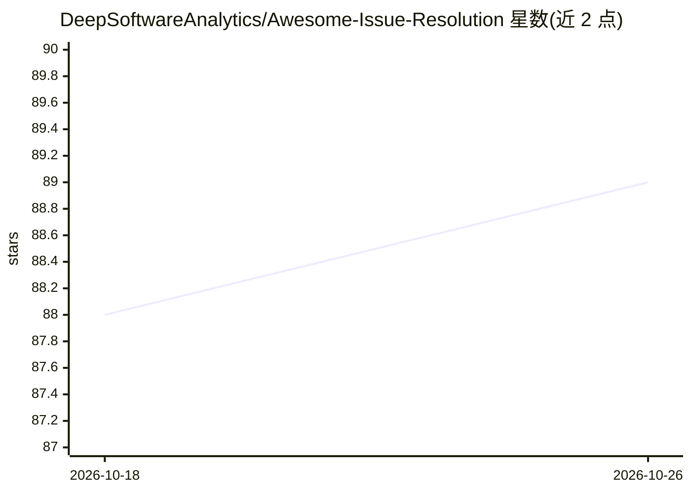

# DeepSoftwareAnalytics/Awesome-Issue-Resolution

⭐ 89 · Python · 推送 2026-09-23 · [GitHub](https://github.com/DeepSoftwareAnalytics/Awesome-Issue-Resolution) · [官网](https://deepsoftwareanalytics.github.io/Awesome-Issue-Resolution/) · 组织维护

**LLM 驱动的软件 issue 自动解决综述与论文清单（286 篇，14 类）**

一项软件工程领域的系统性综述项目：基于对 286 篇论文与在线资源的系统综述，构建 LLM 自动解决 GitHub issue 的理论框架，涵盖评测数据集、训练数据集、免训练方法（agent/工作流）、基于训练的方法（SFT/RL）与分析。仓库按 14 个类别持续更新论文清单，提供可搜索可导出的论文数据库网站，并附带本地 skill（./skill/survey-repo-explorer）从 README 抽取分类论文链接构建知识库，供 agent 辅助文献探索。面向软件工程与 LLM 研究者。

## 筛选速览

| 维度 | 判定 | 备注 |
|---|---|---|
| AI 角色 | `ai-knowledge` | 知识聚合/清单类 |
| 许可风险 | `none` | — |
| 部署形态 | `self-host` | docker 或自建部署 |
| 模型依赖 | — | README 未给出锁定关系 |
| 硬件要求 | — | 无带数字的原话,不猜 |
| 安装摩擦 | `low` | 无编译、无系统依赖或容器化 |
| 成熟度 | — | 结构信号不足 |

## 能力要点

- 系统综述 286 篇论文，按 14 个类别组织并持续更新
- 覆盖评测/训练数据集与免训练、SFT/RL 两类方法
- 提供可按类别/日期/关键词过滤并导出 CSV 的论文数据库
- 本地 survey-repo-explorer skill 支持构建结构化文献知识库

## 适用场景

- 查找 SWE issue 解决领域的评测基准与训练数据集
- 跟踪 coding agent 方法的最新论文进展
- 用 agent 辅助浏览该领域的文献知识库

## 场景标签

`精选清单` `科研工具` · 领域:学习与行业

## 证据(README 行号)

> L28: Based on systematic review of **286 papers and online resources**, this survey establishes a holistic theoretical f
> L80: > **Total: 286 works** across 14 categories

## 星数曲线

2026-10-18 88 → 2026-10-26 89（+1）

---
*卡片 v1 · prompt 1.4 · 生成 2026-10-23 · 置信度 mid · 依据 README sha `dee6d2268599` · [字段定义](../../DATASET.md)*
