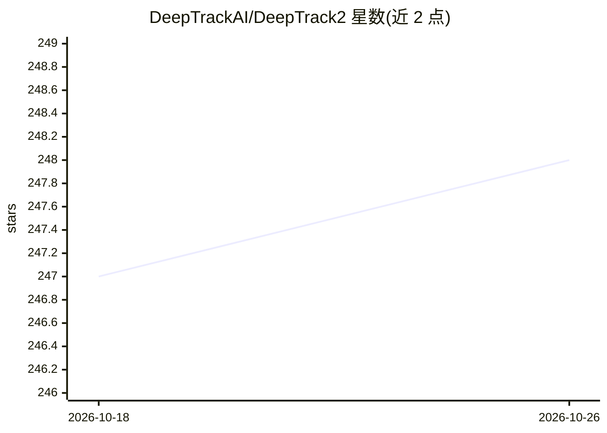

# DeepTrackAI/DeepTrack2

⭐ 248 · Jupyter Notebook · MIT · 推送 2026-10-09 · [GitHub](https://github.com/DeepTrackAI/DeepTrack2) · [官网](https://deeptrackai.github.io/DeepTrack2/) · 组织维护

**数字显微镜深度学习库：模拟成像并训练模型追踪/检测粒子**

面向数字显微成像的模块化 Python 库，用流水线生成、处理和分析图像数据：模拟光学系统（像差、噪声、明场/荧光/全息/TEM 等模态）合成带标注的训练图像，用于训练 CNN、U-Net 等网络完成粒子追踪、细胞计数与检测；内置 LodeSTAR 单样本自监督检测与 MAGIK 图神经网络轨迹链接。基于 PyTorch，2.0 起不再支持 TensorFlow（需回退 1.7）。提供 pip 安装、40+ 教程 notebook 与 Colab 示例。

## 筛选速览

| 维度 | 判定 | 备注 |
|---|---|---|
| AI 角色 | `ai-native` | 本体是模型或模型工具 |
| 许可风险 | `permissive` | MIT |
| 部署形态 | `library` | 以包/库形式分发 |
| 模型依赖 | — | README 未给出锁定关系 |
| 硬件要求 | — | 无带数字的原话,不猜 |
| 安装摩擦 | `low` | 无编译、无系统依赖或容器化 |
| 成熟度 | — | 结构信号不足 |

## 能力要点

- 流水线模拟显微镜成像（像差/噪声/多种成像模态）并生成训练数据
- 粒子追踪、细胞计数、无监督目标检测（LodeSTAR）等示例
- MAGIK 图神经网络实现细胞轨迹链接与运动特征分析
- 提供 40+ 教程 notebook 与 Colab 在线运行

## 适用场景

- 模拟显微图像生成合成训练数据，缓解实验标注数据不足
- 训练 CNN/U-Net 做粒子追踪、细胞计数与检测
- 无标注条件下用 LodeSTAR 做单样本目标检测

## 场景标签

`图像视频处理` `目标检测` `教程课程` · 领域:学习与行业

## 证据(README 行号)

> L27: DeepTrack2 is a modular Python library for generating, manipulating, and analyzing image data pipelines for machine
> L64: - DTGS121 **Tracking a Point Particle with a CNN**
> L151:  <a href="https://doi.org/10.1364/OPTICA.6.000506" alt="DeepTrack article">

## 星数曲线

2026-10-18 247 → 2026-10-26 248（+1）

---
*卡片 v1 · prompt 1.4 · 生成 2026-10-22 · 置信度 high · 依据 README sha `14ad2cc136cc` · [字段定义](../../DATASET.md)*
