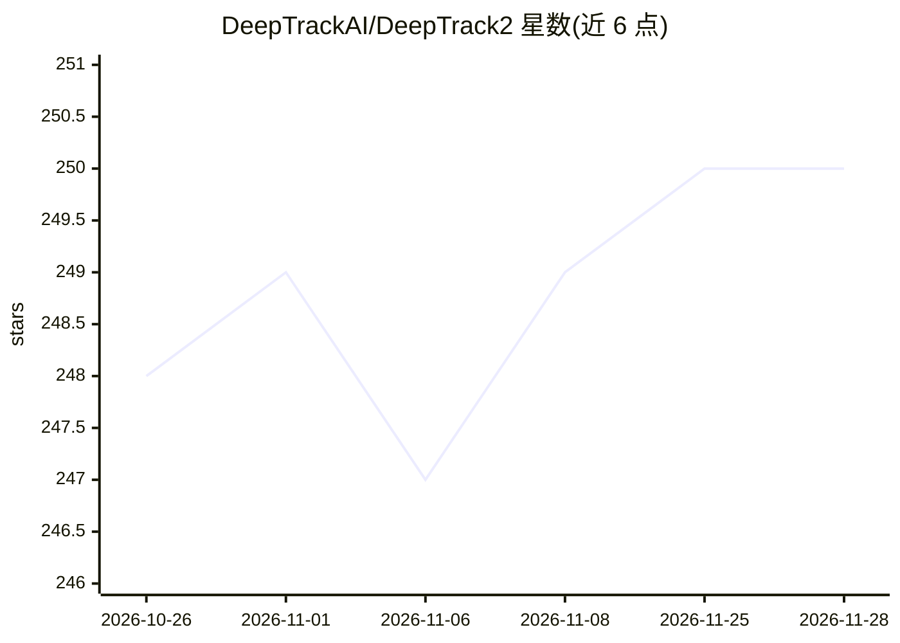

# DeepTrackAI/DeepTrack2

⭐ 250 · Jupyter Notebook · MIT · 推送 2026-11-26 · [GitHub](https://github.com/DeepTrackAI/DeepTrack2) · [官网](https://deeptrackai.github.io/DeepTrack2/) · 组织维护

**面向显微成像的深度学习图像管线 Python 库**

DeepTrack2 是一个模块化 Python 库，用于生成、处理和分析面向机器学习与数字显微的图像数据管线。核心机制包括光学散射体与成像模拟、数据增强、CNN/U-Net 训练与粒子追踪检测（含 LodeSTAR 自监督检测、MAGIK 图神经网络追踪）。要求 Python 3.10 以上，通过 pip 安装并自动装依赖；2.0 版起不支持 TensorFlow，需 TensorFlow 须改用 1.7 版。附入门、进阶、开发者教程与文档站。

## 筛选速览

| 维度 | 判定 | 备注 |
|---|---|---|
| AI 角色 | `ai-native` | 本体是模型或模型工具 |
| 许可风险 | `permissive` | MIT |
| 部署形态 | `library` | 以包/库形式分发 |
| 模型依赖 | — | README 未给出锁定关系 |
| 硬件要求 | — | 无带数字的原话,不猜 |
| 安装摩擦 | `low` | 无编译、无系统依赖或容器化 |
| 成熟度 | — | 结构信号不足 |

## 能力要点

- 光学成像模拟管线：散射体、光学系统、全息、像差、噪声、增强
- 内置 LodeSTAR 自监督单发检测与 MAGIK 图神经网络粒子追踪
- PyTorch 梯度拟合与可微优化管线
- 覆盖 GUV、细菌、细胞核、TEM 等多类显微图像模拟教程

## 适用场景

- 在显微视频中用 CNN/U-Net 追踪单颗粒子与多粒子
- 用模拟图像训练模型完成细胞计数与组织分割
- 对光学器件做像差表征并联合优化相位掩膜
- 为实验成像生成带标注的训练数据

## 场景标签

`图像视频处理` `目标检测` · 领域:感知与多模态

## 证据(README 行号)

> L27: DeepTrack2 is a modular Python library for generating, manipulating, and analyzing image data pipelines for machine
> L64: - DTGS121 **Tracking a Point Particle with a CNN**
> L86:  Single-shot unsupervised object detection using LodeSTAR.

## 星数曲线

2026-10-26 248 → 2026-11-28 250（+2）

---
*卡片 v1 · prompt 1.4 · 生成 2026-11-25 · 置信度 high · 依据 README sha `c34c6e127196` · [字段定义](../../DATASET.md)*
