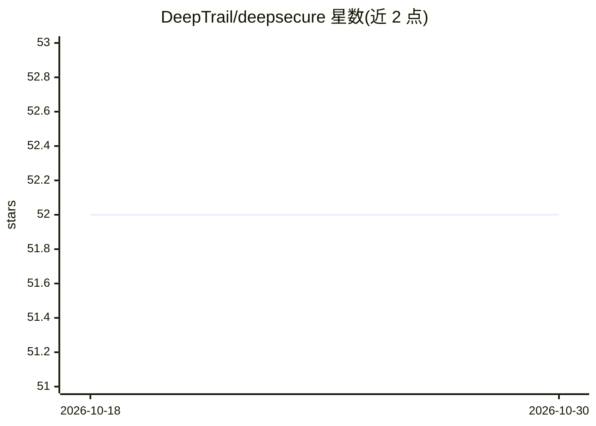

# DeepTrail/deepsecure

⭐ 52 · Python · Apache-2.0 · 推送 2026-02-05 · [GitHub](https://github.com/DeepTrail/deepsecure) · 组织维护

**为 AI agent 提供身份认证与密钥管理的安全基础设施**

面向 AI agent 开发者的身份与凭证管理平台：为每个 agent 签发 Ed25519 加密身份与短期临时凭证，agent 本身不接触 API key，由网关在运行时注入密钥；提供策略引擎（细粒度 RBAC 与委托）、不可变审计日志和请求代理。采用双服务架构（deeptrail-control 控制面 + deeptrail-gateway 数据面 + PostgreSQL），通过 Docker Compose 部署，Python SDK 与 CLI 操作，含 LangChain、CrewAI 示例。限制：需 Python 3.9+、OS keyring 与 Docker 环境。Apache 2.0 许可。

## 筛选速览

| 维度 | 判定 | 备注 |
|---|---|---|
| AI 角色 | `ai-ecosystem` | LLM/agent 周边工具 |
| 许可风险 | `permissive` | Apache-2.0 |
| 部署形态 | `self-host` | docker 或自建部署 |
| 模型依赖 | — | README 未给出锁定关系 |
| 硬件要求 | — | 无带数字的原话,不猜 |
| 安装摩擦 | `low` | 无编译、无系统依赖或容器化 |
| 成熟度 | — | 结构信号不足 |

## 能力要点

- 每个 agent 获 Ed25519 加密身份与临时凭证，不持有明文 API key
- 双服务架构：控制面管理身份/策略/凭证，数据面网关注入密钥并执行策略
- 细粒度 RBAC 策略、加密委托与不可变审计日志
- 提供 Python SDK、CLI 及 LangChain/CrewAI 示例

## 适用场景

- 多 agent 系统中统一管理身份与密钥，避免 API key 散落
- 为 agent 工具调用做细粒度访问控制与合规审计
- 生产环境部署带策略执行的 agent 密钥注入网关

## 场景标签

`网络安全` · 领域:学习与行业

## 证据(README 行号)

> L37:  **Give every AI agent a cryptographic identity and authenticated ephemeral credentials.
> L89: DeepSecure uses a dual-service architecture:
> L151: ### 🧠 Control Plane (`deeptrail-control`)

## 星数曲线

2026-10-18 52 → 2026-10-30 52（+0）

---
*卡片 v1 · prompt 1.4 · 生成 2026-10-24 · 置信度 high · 依据 README sha `0a48ddf672ad` · [字段定义](../../DATASET.md)*
