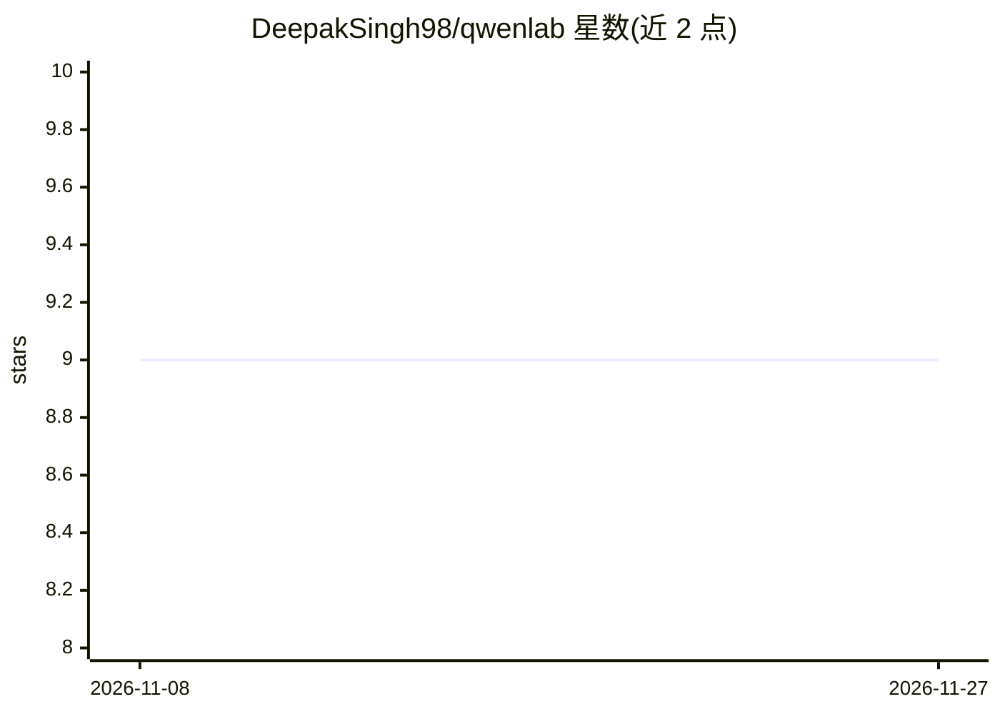

# DeepakSingh98/qwenlab

⭐ 9 · Python · MIT · 推送 2026-11-04 · [GitHub](https://github.com/DeepakSingh98/qwenlab) · 个人维护

**把小型 ML 实验室编译进 Qwen3.5-9B 的实验性模型**

一个实验性项目：在 Qwen3.5-9B 的 32 层之外追加 2,382 层按构造设定权重的'实验室'电路，内含 6 个 419,712 参数的小 transformer，用于训练 a+b mod 97 加法任务。模型通过工具调用发出 train/fork/eval 等命令，实验室层执行前向、反向、AdamW 与评估并回传结果，Qwen 依据读数决定下一轮超参数。README 声明其数值与 PyTorch 参考实现逐位对齐，但速度慢于纯 PyTorch（0.64s 对 5.5ms 每次更新），且仅有单次会话记录、接口只暴露学习率与权重衰减。

## 筛选速览

| 维度 | 判定 | 备注 |
|---|---|---|
| AI 角色 | `ai-native` | 本体是模型或模型工具 |
| 许可风险 | `permissive` | MIT |
| 部署形态 | `library` | 以包/库形式分发 |
| 模型依赖 | — | README 未给出锁定关系 |
| 硬件要求 | — | 无带数字的原话,不猜 |
| 安装摩擦 | `medium` | 含编译或系统依赖之一 |
| 成熟度 | `idea` | |

## 能力要点

- 6 个小 transformer 编译进 Qwen3.5-9B，共 2,382 层实验室电路
- 训练、fork、评估全部在模型前向中执行，宿主仅逐位置采样 token
- float64 验证与 PyTorch 参考实现误差 1e-15，支持保存/恢复逐位一致
- 权重存储于 DeltaNet 风格记忆头，每单元 1,686 个头

## 适用场景

- 复现模型内运行训练实验的完整会话
- 验证编译电路与 PyTorch 数值一致性
- 研究在模型权重内实现学习算法的可行性

## 场景标签

`模型训练` · 领域:训练与推理

## 证据(README 行号)

> L3: **qwenLab is an experimental model: Qwen3.5-9B with a small ML research lab compiled into it.**
> L73: One session, `results/research_r6` (8 minutes on one H100). The prompt fixed the protocol: train A for 200 updates,

## 星数曲线

2026-11-08 9 → 2026-11-27 9（+0）

---
*卡片 v1 · prompt 1.4 · 生成 2026-11-20 · 置信度 high · 依据 README sha `77588d923ec2` · [字段定义](../../DATASET.md)*
