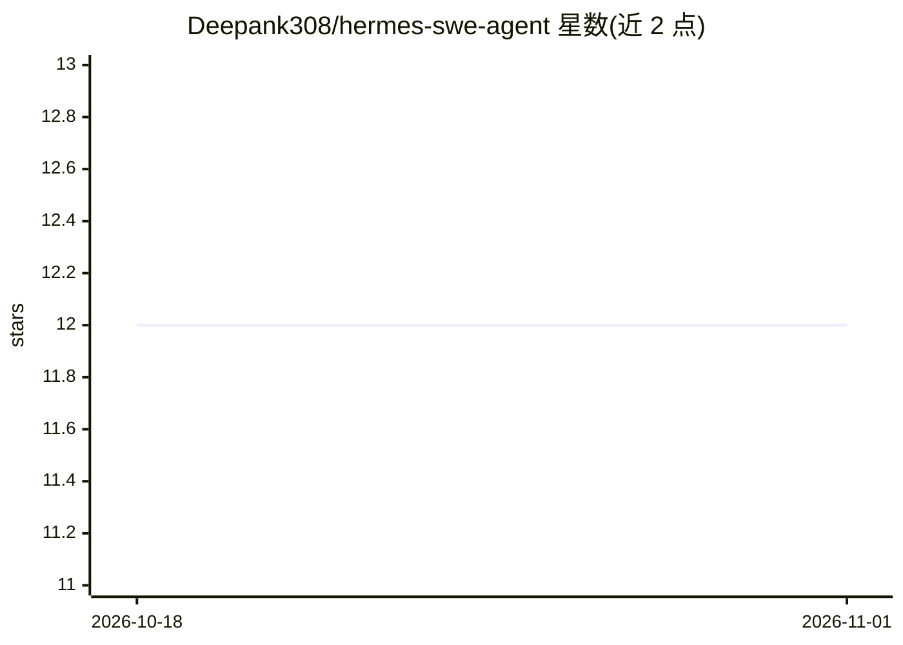

# Deepank308/hermes-swe-agent

⭐ 12 · TypeScript · MIT · 推送 2026-04-09 · [GitHub](https://github.com/Deepank308/hermes-swe-agent) · [官网](https://deepwiki.com/Deepank308/hermes-swe-agent) · 个人维护

**由 Linear 工单触发的自主 AI 编码代理：自动写码测试开 PR**

面向工程团队的自主编码代理：把 Linear 工单分配给 agent 后，在 AWS EC2 上启动带 Docker/PostgreSQL/Redis 及完整应用栈的独立开发环境，由 Claude Code 读代码、规划、写码并跑测试，进度实时回传 Linear，通过 Cloudflare 命名隧道生成预览 URL，完成后开 PR、销毁实例并通知 Slack。支持工单分类路由、会话恢复、队列与崩溃恢复、MCP 集成及 iptables 出站白名单等网络隔离。需自备 AWS/Cloudflare/Linear/GitHub 等账号并配置 ANTHROPIC_API_KEY，非 Anthropic 官方项目。

## 筛选速览

| 维度 | 判定 | 备注 |
|---|---|---|
| AI 角色 | `ai-native` | 本体是模型或模型工具 |
| 许可风险 | `permissive` | MIT |
| 部署形态 | `library` | 以包/库形式分发 |
| 模型依赖 | locked-api |  |
| 硬件要求 | — | 无带数字的原话,不猜 |
| 安装摩擦 | `low` | 无编译、无系统依赖或容器化 |
| 成熟度 | — | 结构信号不足 |

## 能力要点

- 工单分类路由：full-development / debugging / simple-question 三种技能
- 每会话独立 EC2 + Docker 完整应用栈，预置 AMI 约 2 分钟启动
- iptables 出站白名单与编排器安全组的网络隔离
- MCP 集成、会话恢复、队列并发与崩溃恢复

## 适用场景

- 把 Linear 工单分配给 agent，自动拿到带测试与预览环境的 PR
- 通过 Linear 评论中途向 agent 追加指令或追问
- 以队列方式批量处理工程工单并接收 Slack 通知

## 场景标签

`编码 Agent` · 领域:编码与开发

## 证据(README 行号)

> L3: > Autonomous AI coding agent triggered by Linear tickets. Assign a ticket, get a PR — with a full dev environment, l
> L22: 2. **Reads the codebase, plans an approach, writes code, runs tests**
> L77: 5. Claude Code reads the codebase, plans, codes, tests

## 星数曲线

2026-10-18 12 → 2026-11-01 12（+0）

---
*卡片 v1 · prompt 1.4 · 生成 2026-11-01 · 置信度 mid · 依据 README sha `9f349d33bac6` · [字段定义](../../DATASET.md)*
