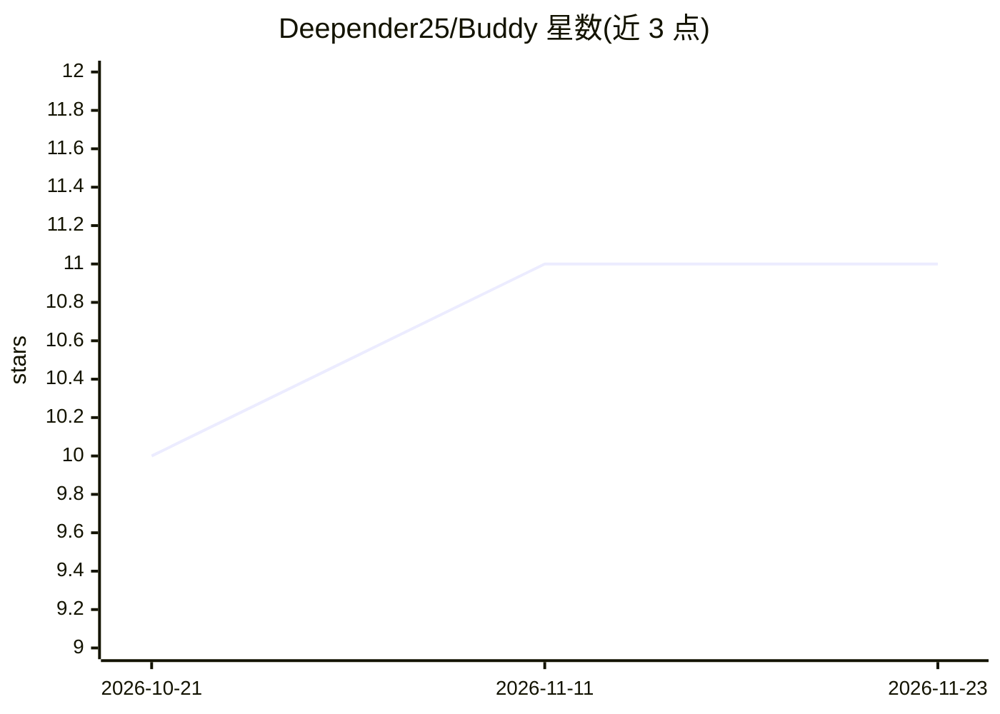

# Deepender25/Buddy

⭐ 11 · Kotlin · MIT · 推送 2026-04-18 · [GitHub](https://github.com/Deepender25/Buddy) · 个人维护

**Android 全局文本 AI 助手：任意应用内触发 /fix 等指令即时改写文本**

以 Android Accessibility Service 形式常驻后台，在任意应用的文本框中检测末尾触发词（如 /fix、/formal、/reply），将文本发送到配置的 AI 提供方（Gemini、Groq 或任意 OpenAI 兼容端点）并就地替换结果。内置 10 个命令，支持自定义触发词/提示词对、多 key 自动轮换、温度调节、历史记录与本地静态文本替换。APK 内置 Python 3.12 解释器（Chaquopy）处理 API 调用，无需额外安装；要求 Android 6.0+，且银行类应用会屏蔽无障碍服务。

## 筛选速览

| 维度 | 判定 | 备注 |
|---|---|---|
| AI 角色 | `ai-native` | 本体是模型或模型工具 |
| 许可风险 | `permissive` | MIT |
| 部署形态 | `desktop` | 安装包/桌面程序 |
| 模型依赖 | locked-api |  |
| 硬件要求 | — | 无带数字的原话,不猜 |
| 安装摩擦 | `medium` | 含编译或系统依赖之一 |
| 成熟度 | — | 结构信号不足 |

## 能力要点

- 任意应用文本框内触发词即时改写与就地替换
- 支持 Gemini、Groq 与任意 OpenAI 兼容端点，多 key 自动轮换
- 10 个内置命令 + 自定义触发词/提示词对
- /undo 回退、静态文本替换、7 天用量仪表盘

## 适用场景

- 在 WhatsApp/Gmail 里快速把草稿改成正式语气
- 给消息生成上下文回复或润色推文、LinkedIn 帖子
- 把文本翻译成任意语言而无需切换应用

## 场景标签

`AI 助手` · 领域:对话与助手

## 证据(README 行号)

> L6: A native Android Accessibility Service that injects AI directly into *any* text field — in *any* app — on the fly.
> L31: Finished typing a WhatsApp message but want it to sound more professional? Type `/formal` at the end. Wrote a rough

## 星数曲线

2026-10-21 10 → 2026-11-23 11（+1）

---
*卡片 v1 · prompt 1.4 · 生成 2026-11-19 · 置信度 high · 依据 README sha `dfd53104f086` · [字段定义](../../DATASET.md)*
