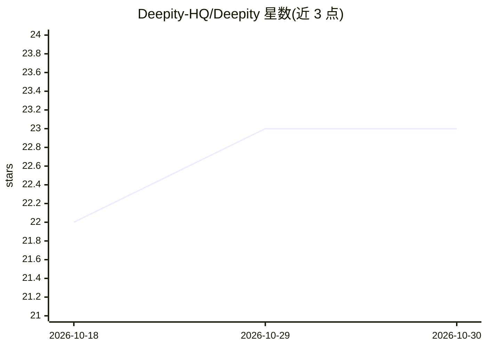

# Deepity-HQ/Deepity

⭐ 23 · C++ · MIT · 推送 2026-10-27 · [GitHub](https://github.com/Deepity-HQ/Deepity) · [官网](deepity.dev) · 个人维护

**C++/CUDA 实现的预测编码网络训练引擎库**

面向科研与高性能计算开发者的裸 C++/CUDA 预测编码网络（PCN）引擎：以逐层局部预测误差替代全局反向传播，避免存储反向计算图，宣称 O(1) 内存占用；提供经典 settling（SimplePCN/FullPCN）与 Direct Kolen-Pollack（DKPPCN）两种训练方式。手写 AVX2/AVX-512/SSE 激活核与 OpenBLAS/MKL 后端，CUDA 后端在 A100 上开发。多数用户经 nanobind 的 pydeepity Python 绑定使用。需从源码经 build.py 构建；ImageNet 规模训练仍在进行中，项目自述从学术研究转型为基础设施工具。

## 筛选速览

| 维度 | 判定 | 备注 |
|---|---|---|
| AI 角色 | `ai-native` | 本体是模型或模型工具 |
| 许可风险 | `permissive` | MIT |
| 部署形态 | `None` |  |
| 模型依赖 | — | README 未给出锁定关系 |
| 硬件要求 | `cpu-ok` | |
| 安装摩擦 | `high` | 编译与系统依赖俱全 |
| 成熟度 | `idea` | |

## 动量与使用信号

- 安装:github 包 `release-assets` 月下载无数据

## 能力要点

- 逐层局部学习规则替代全局反向传播，不存储反向计算图
- SIMD（AVX2/AVX-512/SSE）手写激活核，Tanh/Sigmoid/GELU 各尺寸测得加速
- DKPPCN 变体：2 推理步即可训练，速度/精度权衡曲线另一端
- pydeepity Python 绑定（nanobind）声明网络并训练

## 适用场景

- 用预测编码算法训练小型分类网络（如 MNIST）
- 研究局部学习规则与反向传播的内存/速度差异
- 在 CPU 或 NVIDIA GPU 上跑 PC 训练基准并与 ngc-learn 对照

## 场景标签

`模型训练` · 领域:训练与推理

## 证据(README 行号)

> L5: A high-performance C++ / CUDA engine for Predictive Coding Networks (PCNs) and Direct Kolen-Pollack algorithms.
> L17: Deepity trains networks differently. Each layer holds a belief about its own activity and compares it against a top

## 星数曲线

2026-10-18 22 → 2026-10-30 23（+1）

---
*卡片 v1 · prompt 1.4 · 生成 2026-10-18 · 置信度 high · 依据 README sha `461cf39a1f53` · [字段定义](../../DATASET.md)*
