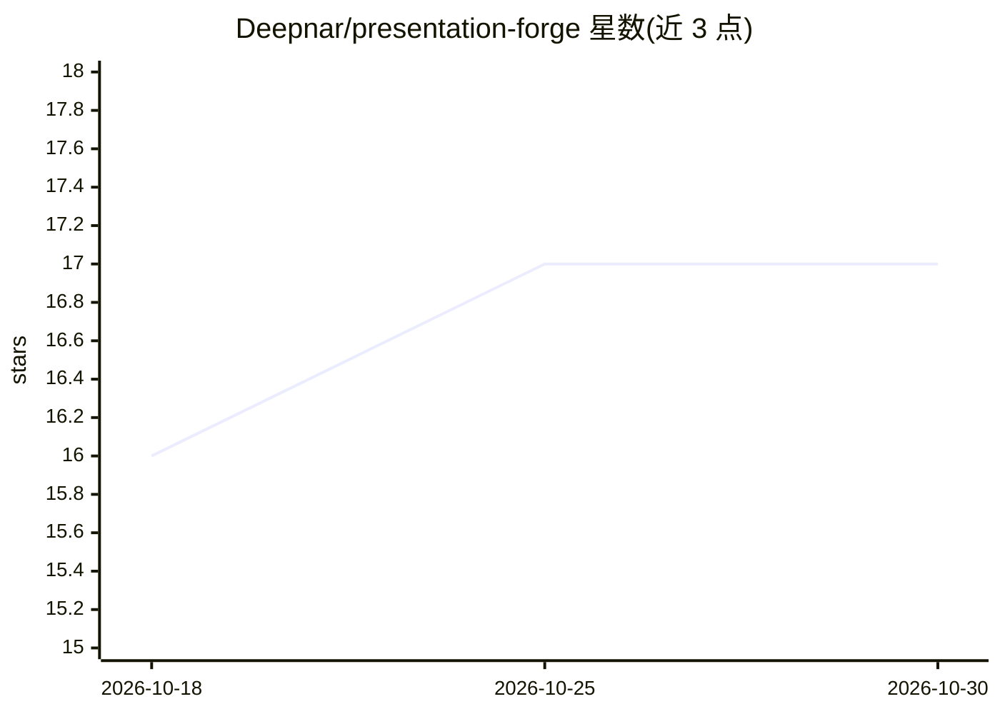

# Deepnar/presentation-forge

⭐ 17 · JavaScript · MIT · 推送 2026-10-29 · [GitHub](https://github.com/Deepnar/presentation-forge) · 个人维护

**本地自托管的 AI 学术演示文稿与报告生成器**

面向学术场景的自托管生成应用：输入主题或资料，经检索（SearXNG/arXiv/Crossref/上传文档）、大纲人工审批、内容生成、渲染与视觉校验，产出主题化的可编辑 PPTX、PDF、DOCX 报告与讲稿。核心机制是模型只写 schema 校验的内容层，不写布局；报告按机构 .docx 模板对齐并评分。支持 74 种幻灯片类型、34 套主题，通过 Docker 部署，可用 Ollama 本地推理或自带 API key。限制：小模型输出质量不稳定，需人工检查预览。

## 筛选速览

| 维度 | 判定 | 备注 |
|---|---|---|
| AI 角色 | `ai-native` | 本体是模型或模型工具 |
| 许可风险 | `permissive` | MIT |
| 部署形态 | `self-host` | docker 或自建部署 |
| 模型依赖 | local-ok | 支持本地模型 |
| 硬件要求 | — | 无带数字的原话,不猜 |
| 安装摩擦 | `low` | 无编译、无系统依赖或容器化 |
| 成熟度 | — | 结构信号不足 |

## 能力要点

- 模型只写内容层（schema 校验 YAML），布局与主题由代码/人工主题承担
- 大纲后设人工审批门，渲染后光栅化读回文本并经视觉 critic 修正
- 报告按机构 .docx 模板渲染，双趟转换生成真实目录页码
- 本地优先：Ollama 推理不出机器，BYOK 模式含 token 预算与护栏

## 适用场景

- 把研究主题变成一套可编辑的主题化学术演示文稿
- 按本院系 Word 模板生成带真实目录页码的配套报告
- 在私有 Docker 环境中用本地模型完成全流程，不出内网

## 场景标签

`科研工具` `AI 写作` · 领域:内容生成

## 证据(README 行号)

> L5:  A topic goes in. A themed deck and a graded report come out.
> L6:  Local-first presentation and report generation for academic work.

## 星数曲线

2026-10-18 16 → 2026-10-30 17（+1）

---
*卡片 v1 · prompt 1.4 · 生成 2026-10-30 · 置信度 high · 依据 README sha `ca7c78fa8476` · [字段定义](../../DATASET.md)*
