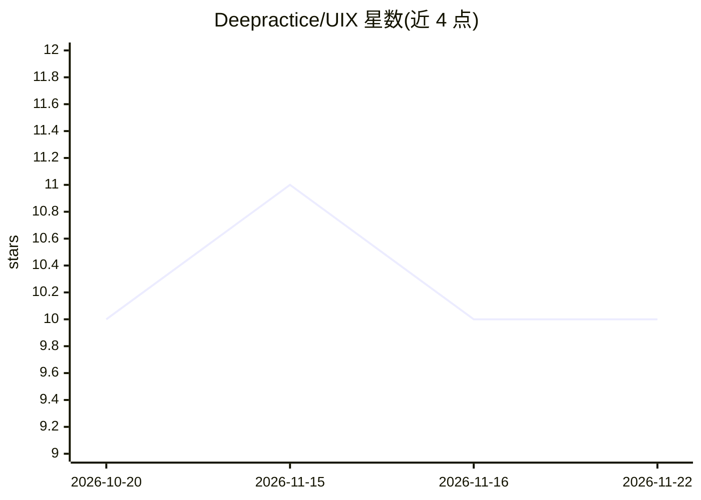

# Deepractice/UIX

⭐ 10 · TypeScript · MIT · 推送 2026-03-14 · [GitHub](https://github.com/Deepractice/UIX) · [官网](https://uix-c3n.pages.dev) · 组织维护 · 中文 README

**将各类 AI 后端输出归一化为统一 IR 格式的协议层**

UIX 是协议层与转换引擎，解决不同 AI 后端（Vercel AI SDK、AgentX、AG-UI、A2UI）输出格式互异导致 UI 层与后端耦合的问题：通过适配器把上游消息、工具调用与流式协议转换为统一的 LucidConversation/LucidBlock IR（含 text/tool/thinking 等块类型与工具 9 状态生命周期），下游可接入 assistant-ui 或自带渲染器。以 TypeScript monorepo 提供 core 与多个适配器包，另附带 Markdown 格式的 AI 可读设计规则（lucid-ui skill），需 pnpm 从源码构建开发。

## 筛选速览

| 维度 | 判定 | 备注 |
|---|---|---|
| AI 角色 | `ai-ecosystem` | LLM/agent 周边工具 |
| 许可风险 | `permissive` | MIT |
| 部署形态 | `library` | 以包/库形式分发 |
| 模型依赖 | — | README 未给出锁定关系 |
| 硬件要求 | — | 无带数字的原话,不猜 |
| 安装摩擦 | `low` | 无编译、无系统依赖或容器化 |
| 成熟度 | — | 结构信号不足 |

## 能力要点

- 统一 IR：LucidConversation 与 7 类 Block（text/tool/thinking/image/file/error/source）
- 适配器架构：Vercel AI SDK 4.x/6.x、AG-UI、A2UI 适配器，纯函数转换
- 工具调用 9 状态生命周期（含 approval 流程）
- Markdown 格式的 AI 可读设计规则，支持 8 个 AI 编码工具平台

## 适用场景

- 切换 AI 后端时无需重写聊天 UI 层
- 将多种 AI 后端输出统一后接入 assistant-ui 渲染
- 为 AI 编码工具提供界面设计规则 skill

## 场景标签

 · 领域:AI 应用开发/前端基础设施

## 证据(README 行号)

> L5:  AI-to-UI Intermediate Representation (IR) Protocol & Conversion Engine
> L17: **UIX is a protocol layer and conversion engine**, not a Chat UI framework.
> L19: If you need a full-featured React chat interface, use assistant-ui — it's excellent and battle-tested. UIX solves a

## 星数曲线

2026-10-20 10 → 2026-11-22 10（+0）

---
*卡片 v1 · prompt 1.4 · 生成 2026-11-20 · 置信度 high · 依据 README sha `ce439d2483cb` · [字段定义](../../DATASET.md)*
