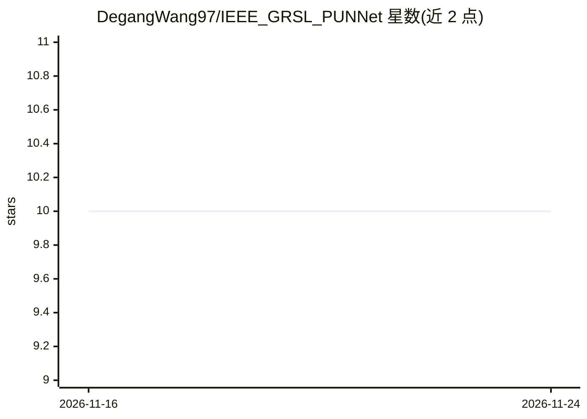

# DegangWang97/IEEE_GRSL_PUNNet

⭐ 10 · Python · GPL-2.0 · 推送 2026-07-14 · [GitHub](https://github.com/DegangWang97/IEEE_GRSL_PUNNet) · [官网](https://ieeexplore.ieee.org/document/10648847) · 个人维护

**面向科研的高光谱异常检测盲点网络官方代码库**

IEEE GRSL 2024 论文 PUNNet 的官方实现：将 patch-shuffle 下采样与带膨胀卷积的 NAFNet 块集成进盲点网络，感受野排除中心像素信息，在自监督范式下重建背景以放大异常的重构误差，用于无需先验知识的高光谱异常检测。基于 Python 3.9 与 PyTorch 1.12，通过 main.py 的 train/predict 命令运行，支持 .mat 格式数据集及自定义数据训练测试。

## 筛选速览

| 维度 | 判定 | 备注 |
|---|---|---|
| AI 角色 | `ai-native` | 本体是模型或模型工具 |
| 许可风险 | `viral` | GPL-2.0 |
| 部署形态 | `None` |  |
| 模型依赖 | — | README 未给出锁定关系 |
| 硬件要求 | — | 无带数字的原话,不猜 |
| 安装摩擦 | `low` | 无编译、无系统依赖或容器化 |
| 成熟度 | `idea` | |

## 能力要点

- patch-shuffle 下采样扩展感受野 + NAFNet 通道注意力捕获全局上下文
- 盲点约束（感受野排除中心像素）支持自监督背景重构检测
- 通过 main.py 命令行完成训练与预测，可自定义数据集与超参

## 适用场景

- 对高光谱图像做自监督异常目标检测
- 复现 GRSL 2024 PUNNet 论文实验结果
- 在自己标注的高光谱数据集上训练检测模型

## 场景标签

`科研工具` `目标检测` · 领域:学习与行业

## 证据(README 行号)

> L8: Hyperspectral anomaly detection (HAD) poses the challenge of distinguishing anomalous targets from the majority of b
> L30: python main.py --command train --dataset HSI-II --epochs 1500 --learning_rate 1e-4 --factor 2 --gpu_ids 0

## 星数曲线

2026-11-16 10 → 2026-11-24 10（+0）

---
*卡片 v1 · prompt 1.4 · 生成 2026-11-20 · 置信度 high · 依据 README sha `4e876170fd47` · [字段定义](../../DATASET.md)*
