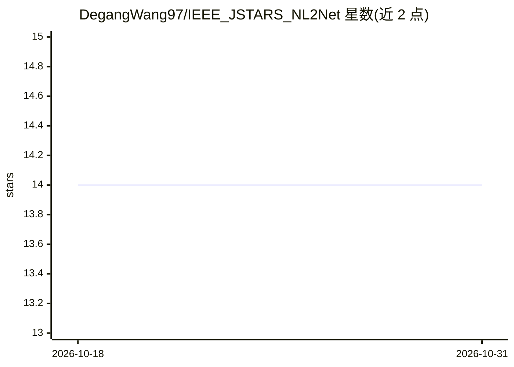

# DegangWang97/IEEE_JSTARS_NL2Net

⭐ 14 · Python · GPL-2.0 · 推送 2026-07-14 · [GitHub](https://github.com/DegangWang97/IEEE_JSTARS_NL2Net) · [官网](https://ieeexplore.ieee.org/document/10890991) · 个人维护

**高光谱异常检测自监督网络 NL2Net 的 PyTorch 官方实现**

IEEE JSTARS 论文 "Non-Local and Local Feature-Coupled Self-Supervised Network for Hyperspectral Anomaly Detection" 的官方代码库。提出双分支结构：局部分支用中心掩码与空洞卷积提取空间-光谱特征，非局部分支用简化自注意力捕捉长程依赖，通过重建纯背景、抑制异常特征实现无先验异常定位。基于 AP-BSN 与 SS-BSN 代码实现，需 Python 3.9 + PyTorch 1.12 环境，读取 .mat 格式数据集，用 main.py 训练与预测。

## 筛选速览

| 维度 | 判定 | 备注 |
|---|---|---|
| AI 角色 | `ai-native` | 本体是模型或模型工具 |
| 许可风险 | `viral` | GPL-2.0 |
| 部署形态 | `None` |  |
| 模型依赖 | — | README 未给出锁定关系 |
| 硬件要求 | — | 无带数字的原话,不猜 |
| 安装摩擦 | `low` | 无编译、无系统依赖或容器化 |
| 成熟度 | — | 结构信号不足 |

## 能力要点

- 局部/非局部双分支特征耦合架构
- 中心块掩码卷积强化背景建模
- 基于 AP-BSN / SS-BSN 代码的 PyTorch 实现

## 适用场景

- 在高光谱影像中无先验定位偏离背景的异常目标
- 复现论文实验或在自己的 HSI 数据上训练测试

## 场景标签

`目标检测` · 领域:感知与多模态

## 证据(README 行号)

> L2: This is the official repository for "Non-Local and Local Feature-Coupled Self-Supervised Network for Hyperspectral A
> L8: Hyperspectral anomaly detection (HAD) aims to locate targets deviating from the background distribution in hyperspec

## 星数曲线

2026-10-18 14 → 2026-10-31 14（+0）

---
*卡片 v1 · prompt 1.4 · 生成 2026-10-31 · 置信度 high · 依据 README sha `dcb99bd16b13` · [字段定义](../../DATASET.md)*
