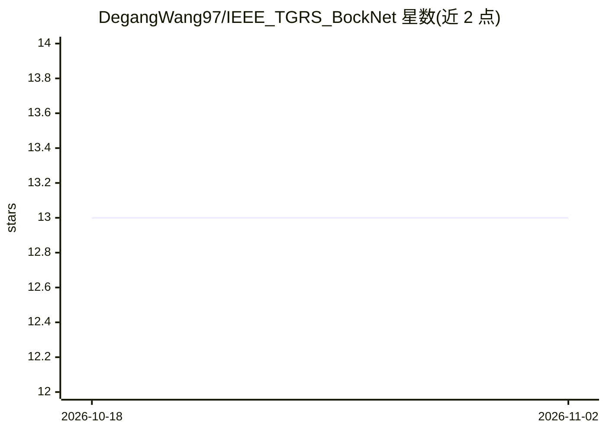

# DegangWang97/IEEE_TGRS_BockNet

⭐ 13 · Python · GPL-2.0 · 推送 2026-07-14 · [GitHub](https://github.com/DegangWang97/IEEE_TGRS_BockNet) · [官网](https://ieeexplore.ieee.org/abstract/document/10330742) · 个人维护

**高光谱异常检测研究代码：带保护窗的自监督盲块重建网络**

IEEE TGRS 2023 论文 BockNet 的官方 PyTorch 实现，面向遥感与计算机视觉研究者。核心机制为在感受野中心设置盲块（保护窗），仅用外窗信息重建中心像素，使重建结果收敛于背景分布，从而放大异常像素重建误差以区分异常目标。属于自监督方法，无需标注数据。仓库提供训练与测试命令行脚本，需准备 .mat 格式数据集，实验环境为 Python 3.9 与 PyTorch 1.12，在四个数据集上进行了实验。

## 筛选速览

| 维度 | 判定 | 备注 |
|---|---|---|
| AI 角色 | `ai-native` | 本体是模型或模型工具 |
| 许可风险 | `viral` | GPL-2.0 |
| 部署形态 | `None` |  |
| 模型依赖 | — | README 未给出锁定关系 |
| 硬件要求 | — | 无带数字的原话,不猜 |
| 安装摩擦 | `low` | 无编译、无系统依赖或容器化 |
| 成熟度 | — | 结构信号不足 |

## 能力要点

- 盲块+保护窗的双滑窗重建机制用于异常检测
- 自监督训练，无需标注的高光谱图像
- 提供 train/predict 命令行脚本，支持调节保护窗宽度等参数
- 在四个数据集上进行实验

## 适用场景

- 复现论文的高光谱异常检测实验
- 在自有 .mat 高光谱数据上训练与测试异常检测
- 以该网络为基线开展遥感异常检测研究

## 场景标签

`目标检测` · 领域:感知与多模态

## 证据(README 行号)

> L2: This is the official repository for "BockNet: Blind-Block Reconstruction Network with a Guard Window for Hyperspectr
> L8: Hyperspectral anomaly detection (HAD) aims to identify anomalous targets that deviate from the surrounding backgroun

## 星数曲线

2026-10-18 13 → 2026-11-02 13（+0）

---
*卡片 v1 · prompt 1.4 · 生成 2026-10-31 · 置信度 high · 依据 README sha `f9ee8c0d6fa8` · [字段定义](../../DATASET.md)*
