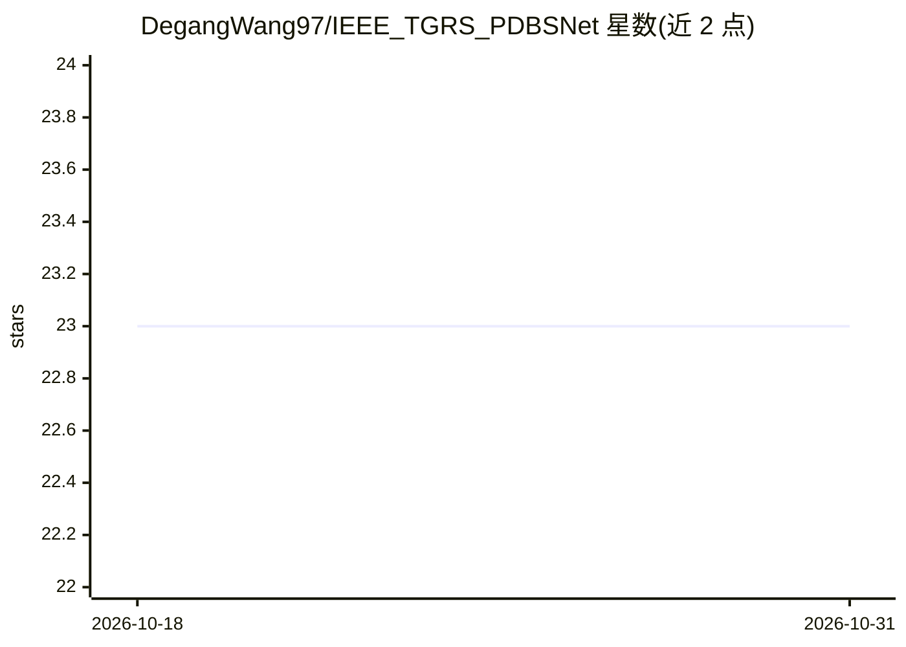

# DegangWang97/IEEE_TGRS_PDBSNet

⭐ 23 · Python · GPL-2.0 · 推送 2026-07-14 · [GitHub](https://github.com/DegangWang97/IEEE_TGRS_PDBSNet) · [官网](https://ieeexplore.ieee.org/abstract/document/10124448) · 个人维护

**高光谱图像异常检测的自监督盲点重建网络（TGRS 2023）**

IEEE TGRS 2023 论文 PDBSNet 的官方 PyTorch 代码实现。面向高光谱异常检测（HAD）任务：采用中心像素盲点架构，用邻域像素重建中心像素光谱信息，并结合像素洗牌下采样（PD）策略打断异常目标的空间相关性，使异常像素产生高重建误差、背景像素低误差，以原图与重建图差异作为异常分数。README 给出环境要求（Python 3.9.12、PyTorch 1.12.1 等）、.mat 数据准备方式与 main.py 训练/测试命令，代码基于 AP-BSN 构建。

## 筛选速览

| 维度 | 判定 | 备注 |
|---|---|---|
| AI 角色 | `ai-native` | 本体是模型或模型工具 |
| 许可风险 | `viral` | GPL-2.0 |
| 部署形态 | `None` |  |
| 模型依赖 | — | README 未给出锁定关系 |
| 硬件要求 | — | 无带数字的原话,不猜 |
| 安装摩擦 | `low` | 无编译、无系统依赖或容器化 |
| 成熟度 | — | 结构信号不足 |

## 能力要点

- 盲点架构：网络不可见中心像素，用邻域重建其光谱信息
- 像素洗牌下采样（PD）策略打断异常目标空间相关性
- 自监督训练，无需标注样本
- 提供训练与测试命令行脚本（main.py）

## 适用场景

- 在高光谱遥感图像中检测异常目标
- 复现论文中的检测实验
- 基于自有 .mat 高光谱数据训练检测模型

## 场景标签

`目标检测` · 领域:感知与多模态

## 证据(README 行号)

> L2: This is the official repository for "PDBSNet: Pixel-Shuffle Downsampling Blind-Spot Reconstruction Network for Hyper
> L8: Recent years have witnessed significant advances of deep learning technology in hyperspectral anomaly detection (HAD
> L30: python main.py --command train --dataset HSI-II --epochs 3000 --learning_rate 1e-4 --factor_train 3 --factor_test 3

## 星数曲线

2026-10-18 23 → 2026-10-31 23（+0）

---
*卡片 v1 · prompt 1.4 · 生成 2026-10-27 · 置信度 high · 依据 README sha `23a1c2641be6` · [字段定义](../../DATASET.md)*
