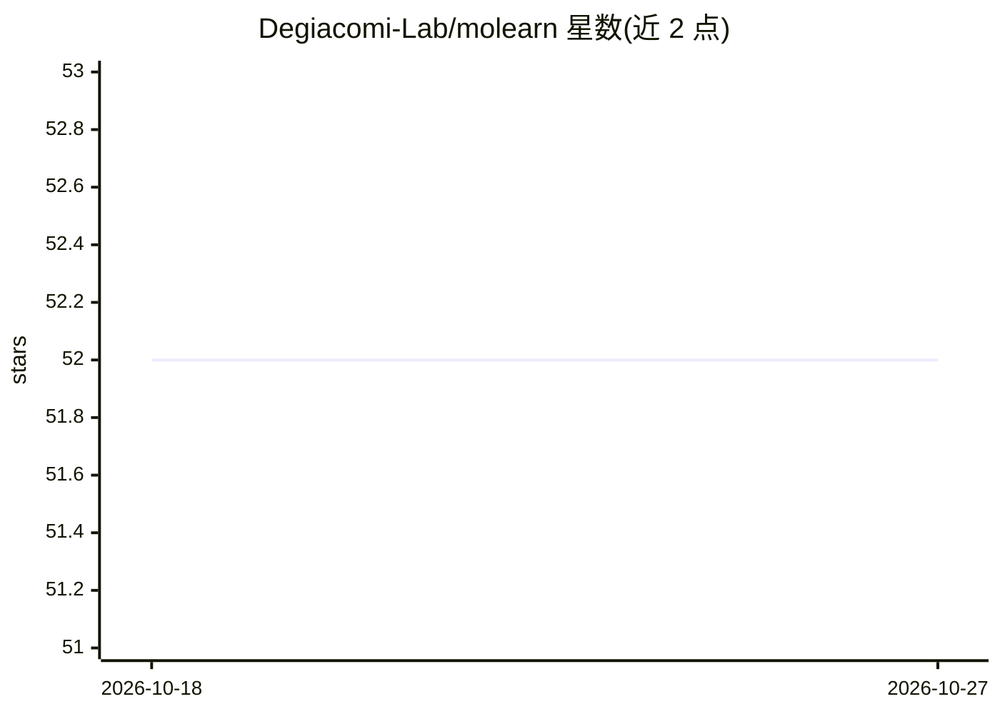

# Degiacomi-Lab/molearn

⭐ 52 · Python · GPL-3.0 · 推送 2026-09-28 · [GitHub](https://github.com/Degiacomi-Lab/molearn) · [官网](https://degiacomi.org/software/molearn/) · 组织维护

**面向科研的蛋白质构象生成机器学习 Python 库**

molearn 是简化蛋白质构象生成式机器学习模型实现的 Python 包，从实验或分子模拟数据中学习并生成蛋白质构象。仓库含源码、API 文档、示例训练与分析脚本及示例数据。必需依赖 numpy、PyTorch、Biobox、MDAnalysis；可选依赖支持 OpenMM 能量评估、Sinkhorn 距离、DOPE/Ramachandran 评分与 GUI。当前版本仅支持 Linux（Python>=3.9），可经 conda-forge、pip 源码安装或免安装使用。

## 筛选速览

| 维度 | 判定 | 备注 |
|---|---|---|
| AI 角色 | `ai-native` | 本体是模型或模型工具 |
| 许可风险 | `viral` | GPL-3.0 |
| 部署形态 | `library` | 以包/库形式分发 |
| 模型依赖 | — | README 未给出锁定关系 |
| 硬件要求 | — | 无带数字的原话,不猜 |
| 安装摩擦 | `low` | 无编译、无系统依赖或容器化 |
| 成熟度 | — | 结构信号不足 |

## 能力要点

- 从实验或分子模拟数据生成蛋白质构象的机器学习框架
- 提供示例训练与分析脚本及示例数据
- 可选集成 OpenMM 能量评估、geomloss Sinkhorn 距离、DOPE/Ramachandran 评分
- 文档含 API 与 FAQ（molearn.readthedocs.io）

## 适用场景

- 基于分子动力学轨迹训练蛋白质构象生成模型
- 分析生成构象的能量与结构合理性
- 科研工作中复现与扩展构象空间学习方法

## 场景标签

`科研工具` · 领域:学习与行业

## 证据(README 行号)

> L10: molearn is a Python package streamlining the implementation of machine learning models dedicated to the generation 
> L90: If you use `molearn` in your work, please cite: S.C. Musson and M.T. Degiacomi (2023). Molearn: a Python package st

## 星数曲线

2026-10-18 52 → 2026-10-27 52（+0）

---
*卡片 v1 · prompt 1.4 · 生成 2026-10-24 · 置信度 high · 依据 README sha `7016f3048f67` · [字段定义](../../DATASET.md)*
