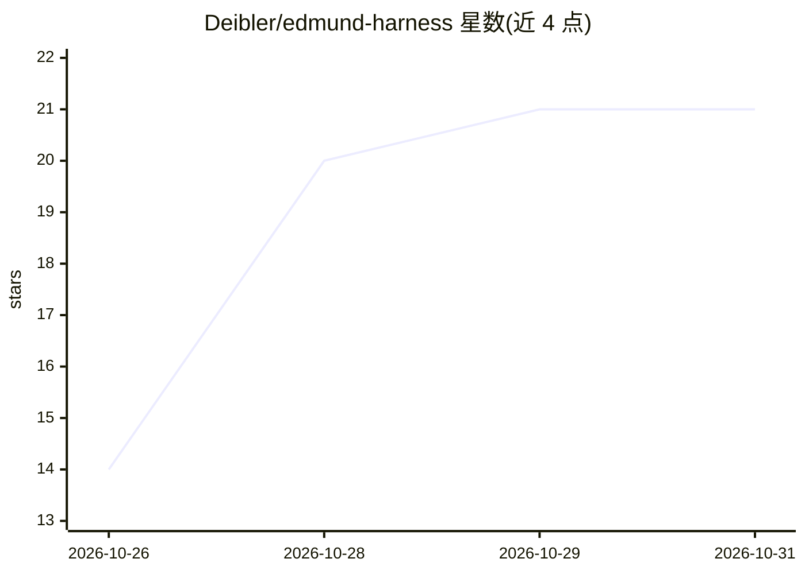

# Deibler/edmund-harness

⭐ 21 · TypeScript · MIT · 推送 2026-10-30 · [GitHub](https://github.com/Deibler/edmund-harness) · 个人维护

**把 Claude Code/Codex 变成亲友可 iMessage 联系的私人助手守护进程**

macOS 守护进程，将 Claude Code 或 Codex CLI 封装为可通过 iMessage 与亲友对话的助手：每个会话独立模型线程、独立记忆文件与工作目录，读取 chat.db 收消息、经注入 Messages.app 的 imcore-bridge 发送（需关闭 SIP）。记忆为 persona/ 下 markdown，含观察-规则归并与搜索索引归档；主动联络由六个确定性门控与预算控制，默认关闭。对话跑在用户已有的 Claude Code/Codex 订阅上，无独立 API key；发送路径依赖私有框架，macOS 26 后升级可能失效。

## 筛选速览

| 维度 | 判定 | 备注 |
|---|---|---|
| AI 角色 | `ai-native` | 本体是模型或模型工具 |
| 许可风险 | `permissive` | MIT |
| 部署形态 | `None` |  |
| 模型依赖 | — | README 未给出锁定关系 |
| 硬件要求 | — | 无带数字的原话,不猜 |
| 安装摩擦 | `low` | 无编译、无系统依赖或容器化 |
| 成熟度 | — | 结构信号不足 |

## 能力要点

- 每会话独立线程/记忆/工作目录，记忆为可编辑的 markdown 规则文件
- 发送经 imcore-bridge 注入 Messages.app，需 SIP 关闭与 AMFI 引导参数
- 主动联络前跑六个确定性门控，冷却随互动衰减，决策写入可读日志
- 发送后核验 chat.db 确认消息落地；OpenRouter 按人计费生成内容

## 适用场景

- 让家人朋友直接通过 iMessage 使用我的 Claude Code/Codex 订阅
- 为每个联系人维护并核验个性化的协作规则记忆
- 在预算与门控约束下让助手主动发起联络

## 场景标签

`AI 助手` `Agent 记忆` · 领域:Agent 开发

## 证据(README 行号)

> L6: edmund-harness is a macOS daemon that turns Claude Code or Codex CLI into
> L7: someone your family and friends can text. Every conversation gets its own model
> L10: allow it. The chat brain runs on your existing Claude Code or Codex

## 星数曲线

2026-10-26 14 → 2026-10-31 21（+7）

---
*卡片 v1 · prompt 1.4 · 生成 2026-10-28 · 置信度 high · 依据 README sha `614c5fe8239e` · [字段定义](../../DATASET.md)*
