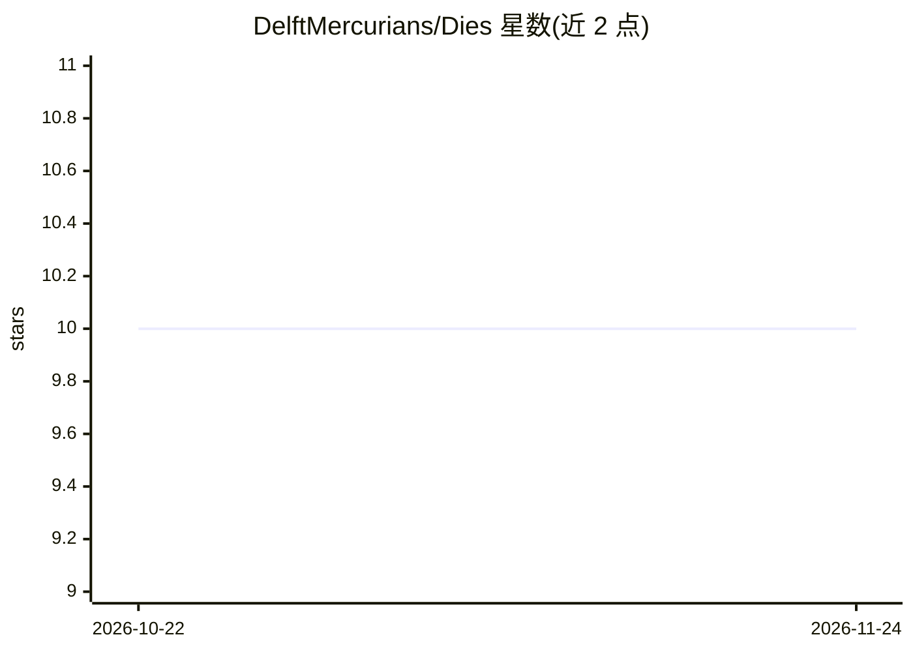

# DelftMercurians/Dies

⭐ 10 · Rust · 推送 2026-11-22 · [GitHub](https://github.com/DelftMercurians/Dies) · [官网](https://delftmercurians.nl/) · 组织维护

**为 RoboCus SSL 机器人足球队提供视觉跟踪、控制与策略运行的框架**

Delft Mercurians 战队的 RoboCup SSL 框架，核心用 Rust 编写，覆盖视觉与裁判网络接收、Kalman 滤波世界状态跟踪、机器人控制与技能执行、带自动裁判的物理仿真器、二进制日志与回放，以及 Web UI。策略以独立 Rust 二进制运行，通过 IPC 与核心通信，可在运行中热替换。提供 headless 自对弈仿真、实时参数调节和 Python 日志分析工具，需 Rust 工具链与 Linux 系统依赖构建运行。

## 筛选速览

| 维度 | 判定 | 备注 |
|---|---|---|
| AI 角色 | `ai-native` | 本体是模型或模型工具 |
| 许可风险 | `none` | — |
| 部署形态 | `library` | 以包/库形式分发 |
| 模型依赖 | — | README 未给出锁定关系 |
| 硬件要求 | — | 无带数字的原话,不猜 |
| 安装摩擦 | `low` | 无编译、无系统依赖或容器化 |
| 成熟度 | — | 结构信号不足 |

## 能力要点

- 视觉帧驱动的完整数据流水线：接收→跟踪→策略→技能→运动规划→下发
- 策略为独立进程，支持改动后热替换而核心持续运行
- 内置物理仿真器与自动裁判，支持确定性 headless 自对弈
- Web UI 实时查看世界状态、调试输出、日志回放与在线调参

## 适用场景

- 为 RoboCup SSL 团队搭建视觉、跟踪与机器人控制的软件栈
- 在仿真器中无实物运行策略自对弈与规则测试
- 回放比赛日志并离线分析比赛数据

## 场景标签

 · 领域:机器人/竞赛

## 证据(README 行号)

> L5: Dies is the framework powering the Delft Mercurians' RoboCup SSL AI. The core is written in Rust: vision and referee
> L47: |3|**Track**|[`WorldTracker`][world-lib]|Kalman-filtered [players][world-player] and [ball][world-ball] ([filters][

## 星数曲线

2026-10-22 10 → 2026-11-24 10（+0）

---
*卡片 v1 · prompt 1.4 · 生成 2026-11-20 · 置信度 mid · 依据 README sha `5d02eaf0829f` · [字段定义](../../DATASET.md)*
