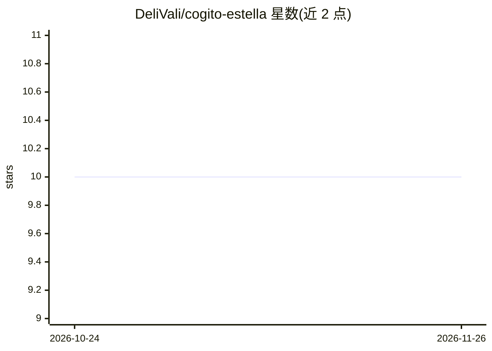

# DeliVali/cogito-estella

⭐ 10 · Python · Apache-2.0 · 推送 2026-10-15 · [GitHub](https://github.com/DeliVali/cogito-estella) · 个人维护

**给 AI agent 提供文档/代码定向问答的 MCP 检索服务器**

以 MCP 服务器与 Python 库形式运行的检索工具：对文件夹中的代码、PDF、Word、Excel 等建立索引，`ask` 工具按问题返回限定 token 预算内、带文件与章节定位的原文行，索引阶段不消耗 LLM token。默认 lite 版基于 IDF 短名单、12 特征学习排序器与多语言句子向量（multilingual-e5-small/ONNX）；full 版加载约 1.9 GB 编码器，用非自回归解码头从文本抽取三元组构成知识图谱，代码图谱来自 tree-sitter，可导出 Neo4j。`setup` 命令向本机已装的十多种编码 agent 客户端注册该服务器。

## 筛选速览

| 维度 | 判定 | 备注 |
|---|---|---|
| AI 角色 | `ai-native` | 本体是模型或模型工具 |
| 许可风险 | `permissive` | Apache-2.0 |
| 部署形态 | `self-host` | docker 或自建部署 |
| 模型依赖 | — | README 未给出锁定关系 |
| 硬件要求 | — | 无带数字的原话,不猜 |
| 安装摩擦 | `low` | 无编译、无系统依赖或容器化 |
| 成熟度 | — | 结构信号不足 |

## 能力要点

- `ask`/`context` 工具返回带文件与行定位的答案片段，索引与检索不耗 LLM token
- lite 版无需 torch/GPU，内含量化 int8 的多语言句子向量（跨语言检索，如西→英 96.6%）
- full 版用 38M 参数非自回归解码头抽取三元组，prose 图 Triple F1 0.852，支持 Neo4j 导出
- `setup` 自动向 Claude Code、Cursor、Gemini CLI 等客户端注册，写前确认并备份

## 适用场景

- 让编码 agent 读取项目代码和文档而不塞满上下文
- 长会话中替代整文件读取以节省 token 开销
- 为小型本地模型提供 context 提示代替工具调用
- 把文档事实抽取为带来源的知识图谱存入 Neo4j

## 场景标签

`RAG` `知识图谱` · 领域:知识与检索

## 证据(README 行号)

> L17: Your agent reads a few hundred tokens instead of whole files. Point Estella at a folder
> L44: |Any MCP client|`cogito-estella setup --print`, or `{"command": "cogito-mcp", "args": ["docs/"]}`|
> L120: The lite index is the default and needs no torch. The full server adds a local model that

## 星数曲线

2026-10-24 10 → 2026-11-26 10（+0）

---
*卡片 v1 · prompt 1.4 · 生成 2026-11-20 · 置信度 mid · 依据 README sha `3e84b7611dcf` · [字段定义](../../DATASET.md)*
