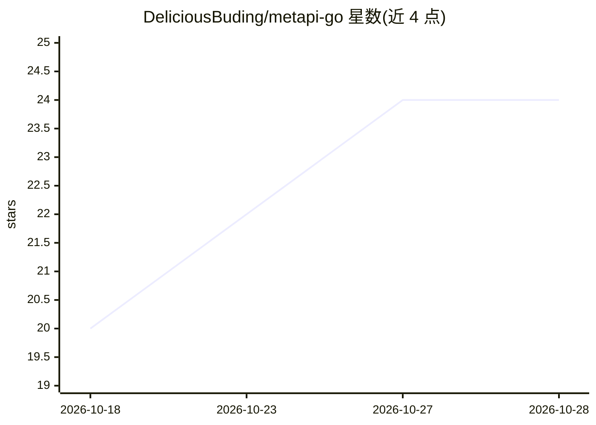

# DeliciousBuding/metapi-go

⭐ 24 · Go · AGPL-3.0 · 推送 2026-10-26 · [GitHub](https://github.com/DeliciousBuding/metapi-go) · 个人维护 · 中文 README

**把多个 AI API 中转站聚合成统一网关的 Go 自托管服务**

面向在多个 New API / One API 系列中转站注册账号的用户，Metapi Go 在其上构建元聚合层：通过 17 个上游适配器（New API、One API、OneHub、OpenAI/Claude/Gemini 兼容端点、Codex/Claude/Gemini CLI OAuth 等）汇聚为一个 API Key、一个入口。提供 OpenAI 与 Claude 双协议统一代理、模型自动发现、按成本/余额加权的智能路由与失败冷却熔断、四级成本计费信号、React 管理界面（预构建嵌入二进制）。单二进制部署，SQLite 默认、PostgreSQL 可选；支持 Docker 镜像（amd64/arm64）与 Release 预编译二进制，源码构建需 Go 1.26.10+ 与 Bun。可从 TypeScript 版同库接管。已知限制：少量管理端点返回 501，多实例共享语义见 FAQ。

## 筛选速览

| 维度 | 判定 | 备注 |
|---|---|---|
| AI 角色 | `ai-ecosystem` | LLM/agent 周边工具 |
| 许可风险 | `viral` | AGPL-3.0 |
| 部署形态 | `desktop` | 安装包/桌面程序 |
| 模型依赖 | locked-api |  |
| 硬件要求 | — | 无带数字的原话,不猜 |
| 安装摩擦 | `low` | 无编译、无系统依赖或容器化 |
| 成熟度 | `idea` | |

## 能力要点

- 17 个上游适配器，覆盖聚合面板、通用兼容接口与 OAuth 连接
- OpenAI/Claude 双协议统一代理（Chat/Messages/Embeddings/Images 等，SSE 流式）
- 智能路由：成本/余额/权重分配、失败冷却重试、运行时熔断与 half-open 探测
- 单二进制即跑，React SPA 嵌入二进制，SQLite 默认/PostgreSQL 可选

## 适用场景

- 把分散在多个中转站的余额与模型统一成一个 API Key 使用
- 让 Cursor、Claude Code、Open WebUI 等下游工具无感接入全部上游模型
- 按成本最优自动选路并逐请求记录 Token 与成本
- 从 Metapi TypeScript 版以同数据库 Schema 无缝迁移到 Go 版

## 场景标签

`模型网关` · 领域:Agent 开发

## 证据(README 行号)

> L5:  中转站的中转站 —— 把分散的 AI API 站点聚合为一个统一网关
> L28: AI 生态里基于 New API / One API 系列的聚合中转站越来越多，多站点的余额、模型列表和 API 密钥往往分散在各处。**Metapi** 是这些中转站之上的**元聚合层（Meta-Aggregation Laye
> L41: |**统一代理**|OpenAI 与 Claude 双协议：Chat / Responses / Messages / Embeddings / Images / Models / Files，SSE 流式；Messages→Ch

## 星数曲线

2026-10-18 20 → 2026-10-28 24（+4）

---
*卡片 v1 · prompt 1.4 · 生成 2026-10-27 · 置信度 high · 依据 README sha `a04c7739c1d5` · [字段定义](../../DATASET.md)*
